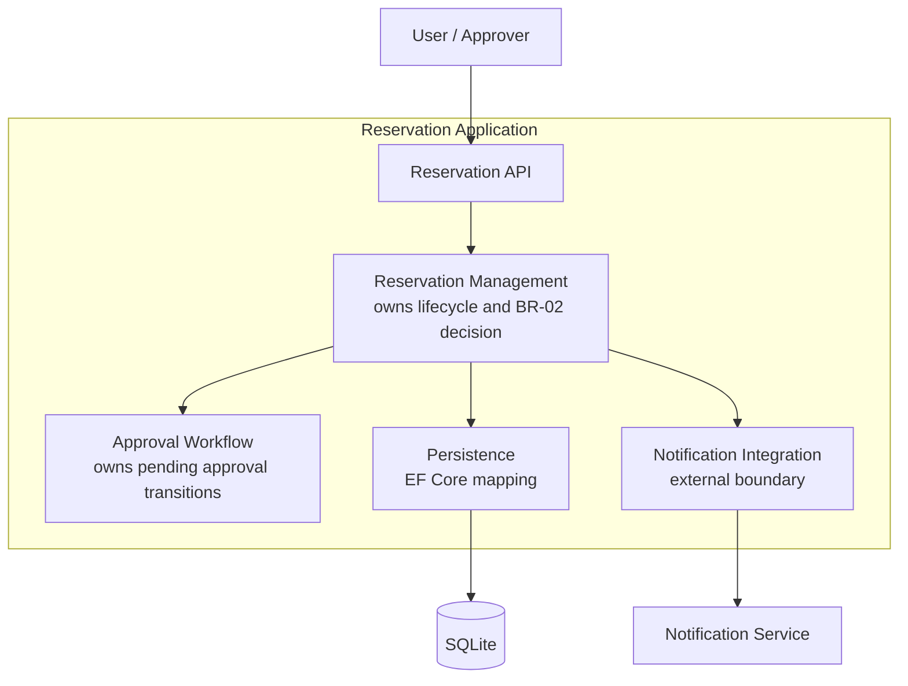
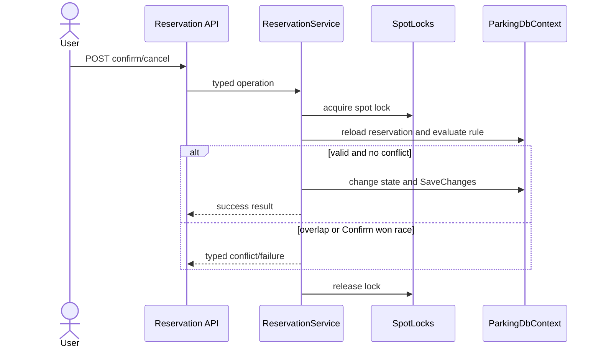

# Architecture and Decisions

## ADR-001: Backend stack

**Decision:** Backend je postaven na ASP.NET Core Web API (.NET 8), s Entity Framework Core a SQLite jako databází.

**Why:**
- .NET 8 je aktuálně nainstalované LTS SDK v prostředí týmu (.NET 9 zatím není k dispozici).
- EF Core + SQLite umožňuje rychlý start bez nutnosti spravovat externí databázový server, zatímco EF Core abstrakce zůstává stejná i při pozdějším přechodu na jiný SQL engine (např. PostgreSQL).
- Swagger/OpenAPI je součástí výchozí šablony a usnadní ruční testování endpointů bez frontendové vrstvy.

**Status:** platí pro C01 — projekt je zatím pouze scaffold (prázdné Web API, nainstalované balíčky), bez entit, `DbContext` nebo endpointů.

## ADR-002: Frontend

**Decision:** Frontend zatím není řešen, složka `frontend/` je připravena jako placeholder.

**Why:** tým se ještě neshodl na technologii/frameworku, priorita C01 je backend doména a datový model.

**Status:** open — doplní se, až padne rozhodnutí.

## ADR-003: Persistence Reservation (výsledek spike A)

**Decision:** Schéma DB se spravuje přes EF Core migrace; stav rezervace se ukládá jako text; časy jsou v UTC; soubor `parking.db` se necommituje.

**Why:** spike A (viz [evidence-and-evolution.md](evidence-and-evolution.md)) ověřil, že uložení a znovunačtení `Reservation` přes EF Core + SQLite funguje včetně migrací. Text ve sloupci `State` je čitelnější při ručním prohlížení DB než číslo enumu.

**Status:** platí. Entity `ParkingSpot`/`User`, cizí klíče a kontrola překryvů jsou otevřené.

## ADR-004: Souběh Confirm/Cancel (OP-03, OP-04)

**Decision:** `ReservationService` serializuje Confirm a Cancel přes `SpotLocks` — in-memory `SemaphoreSlim` na jedno `ParkingSpot.Id`. "Current time" jde přes `IClock` (ne přímo `DateTime.UtcNow`), aby šlo v testech řídit čas deterministicky.

**Why:** REQ-04 a BR-03 vyžadují, aby při souběžných požadavcích na totéž místo vyhrál nejvýše jeden. Pro C02 stačí zámek v rámci jednoho procesu — ověřeno testem se dvěma skutečně paralelními `Task`.

**Status:** platí pro C02. Funguje jen uvnitř jedné instance aplikace/jedné DB — při více instancích (škálování) toto nestačí. To je architektonický driver pro C03, navazuje na zvolenou future pressure **Q** v [intent-and-change.md](intent-and-change.md).

## ADR-005: Schvalovací proces (OP-05, v0.2)

**Decision:** `ParkingSpot.RequiresApproval` (bool) rozhoduje, jestli Confirm (OP-03) vede přímo do `CONFIRMED`, nebo do `PENDING_APPROVAL`. Expirace schvalovacího okna (REQ-08) se řeší líně — kontroluje se při každém dalším dotyku rezervace (Approve/Reject/Cancel), ne časovačem/background jobem. Délka okna je konfigurovatelná (`Reservations:ApprovalWindowHours` v `appsettings.json`), defaultně 24h.

**Why:** Zadání C02 výslovně nechce architektonickou optimalizaci v této fázi ("Neřešte ještě ideální architekturu"). Líné vyhodnocení je nejjednodušší způsob, jak pozorovatelné chování (REQ-08) demonstrovat bez stavění schedulerového subsystému.

**Status:** platí pro C02. Reálný timer/scheduler, který by expiraci vyřídil i bez dalšího požadavku (a mohl by spustit notifikaci), je otevřený architektonický driver pro C03 — stejně jako přesná délka okna, která je v `docs/specification.md` (OP-05) výslovně TBD, ne odsouhlasené pravidlo.

## C03 — Architecture Evidence

### Part A — AS-IS Confirm Reservation

Baseline: v0.2. Scenario: OP-03 Confirm Reservation. Rules: BR-01, BR-02, BR-05. Requirements: REQ-03 and REQ-04.

| Scenario step | Current implementation | Evidence |
|---|---|---|
| Accept confirmation request | Minimal API endpoint binds `ConfirmReservationRequest` and calls the service | `backend/Program.cs`, `MapPost("/reservations/{id:int}/confirm")` |
| Load reservation | `ReservationService` loads by id before acquiring the spot lock | `ReservationService.ConfirmReservationAsync` |
| Serialize decision | `SpotLocks` provides one `SemaphoreSlim` per `ParkingSpot.Id`; the entity is reloaded after the lock | `backend/Services/SpotLocks.cs`, `ReservationService.ConfirmReservationAsync` |
| Validate state, time, and spot activity | Service checks `Draft`, server clock, and `ParkingSpot.IsActive` | `ReservationService.ConfirmReservationAsync`, `IClock` |
| Apply approval branch | `RequiresApproval` changes `Draft` to `PendingApproval`; overlap is deferred | `ReservationService.ConfirmReservationAsync` |
| Enforce BR-02 | Non-approval confirmation queries overlapping `Confirmed` reservations using `[start,end)` predicates | `ReservationService.ConfirmReservationAsync` |
| Persist result | Service changes `Reservation.State` and calls `SaveChangesAsync` | `ReservationService.ConfirmReservationAsync`, `ParkingDbContext` |

Important failure branch: an overlap is detected inside the spot lock, the service returns `ConfirmReservationError.Overlap`, and the reservation remains `Draft`. This is covered by `Confirm_rejected_when_overlaps_existing_confirmed_reservation`.

State is persisted in `Reservations.State` as text through EF Core. `ReservationService` owns the lifecycle decision; `ParkingDbContext` owns persistence mapping. `SpotLocks` is the current concurrency boundary, but it protects only one process.

```mermaid
flowchart LR
	API[Reservation API\nProgram.cs] -->|confirm(id, userId)| Service[ReservationService\nstate, time, approval, overlap]
	Service -->|acquire/release| Locks[SpotLocks\nper-spot SemaphoreSlim]
	Service -->|load/save Reservation| DB[(SQLite\nParkingDbContext)]
	Service -->|read UTC time| Clock[IClock]
```

Architecture question: how should the confirmation decision and BR-02 enforcement remain authoritative when more than one application instance handles requests?

### Drivers, responsibilities, and alternatives

| Source | Driver | Architectural question |
|---|---|---|
| BR-02, REQ-04, Part A | Concurrent confirmations must not create overlapping confirmed reservations | Where is the authoritative allocation decision made? |
| ADR-004, future pressure Q | In-memory locks do not coordinate multiple application instances | What persistence or distributed boundary protects the invariant at scale? |
| BR-05, REQ-08 | Approval state survives the initiating request and may expire later | Who owns pending approval and expiration? |
| Notification boundary, specification TBD | Notification failure semantics are undecided | Is notification best effort, transactional, or retried independently? |

**Decision question:** Where should the authoritative confirmation/approval decision be enforced under concurrency?

**Alternative A — application-process serialization:** retain `SpotLocks` and one deployable. It is simple and matches the current C02 evidence, but it is correct only within one process.

**Alternative B — database-authoritative allocation:** move final conflict protection into a database transaction/constraint strategy, with application locks treated as an optimization. This coordinates multiple instances but requires provider-specific interval and failure handling.

| Driver | Alternative A | Alternative B |
|---|---|---|
| Single-instance correctness | Directly verified by current tests | Also possible, with more machinery |
| Multi-instance correctness | Not sufficient | Can be authoritative across instances |
| Operational complexity | Low | Higher migration and transaction complexity |
| Approval and notification evolution | Remains in one service | Can later separate workers without moving the invariant |

**ADR-006 — Authoritative reservation allocation:** retain `ReservationService` as lifecycle owner and keep `SpotLocks` for the current single-instance baseline. Reopen this decision before multi-instance deployment or when Q becomes an actual operating requirement; then introduce a database-authoritative concurrency mechanism.

Accepted consequence: the current implementation is not a multi-instance solution. This is documented rather than hidden as a quality claim.

### TO-BE views and ownership

For the current scope, the accepted TO-BE remains one Reservation Application process containing Reservation Management, Approval Workflow, Persistence, and Notification Integration boundaries. `ReservationService` owns lifecycle transitions; `SpotLocks` owns process-local serialization; `ParkingDbContext` owns persistence mapping; Notification Integration is reserved for future external delivery.



Runtime mapping: all four logical elements currently run in the ASP.NET Core process; SQLite is the persistence runtime; Notification Service is not integrated in the current code. The design sequence is the Part A call path, with an alternative branch for overlap rejection.

### AS-IS → TO-BE delta

| Area | AS-IS | TO-BE | Action |
|---|---|---|---|
| Reservation lifecycle | `ReservationService` owns transitions | Same owner, explicit in evidence | KEEP |
| Confirm/Cancel race | Process-local lock plus state-aware conflict rejection | Same single-instance rule | KEEP |
| Multi-instance allocation | Not protected across processes | Database-authoritative mechanism required before scaling | VERIFY |
| Approval expiry | Lazy check on access | Same C02 behavior; scheduler remains future work | KEEP |
| Notification Service | Boundary documented, no integration | Isolated integration element when implemented | VERIFY |

### Architecture conformance rule

Rule: only `ReservationService` may mutate `Reservation.State` during application operations. Current repository inspection shows all OP-01–OP-05 state transitions are implemented there; direct state setup appears only in tests and migrations. The repeatable check is `bash scripts/check-architecture-conformance.sh`.

## C05 — Detailed Design

Selected unit: `ReservationService`, focused on `ConfirmReservationAsync` and `CancelReservationAsync`.

Detailed responsibilities:

1. Validate request identity and reservation existence.
2. Serialize same-spot lifecycle decisions.
3. Reload state after lock acquisition.
4. Enforce state, time, activity, approval, and interval rules.
5. Persist exactly one accepted transition and return a typed result.

| Responsibility | Owner | State/data | Contract boundary |
|---|---|---|---|
| Lifecycle decision | `ReservationService` | `Reservation.State` | typed result records |
| Current time | `IClock` | UTC instant | `UtcNow` |
| Same-spot serialization | `SpotLocks` | per-spot semaphore | `Get(spotId)` |
| Persistence | `ParkingDbContext` | Reservations/ParkingSpots | EF Core DbContext |

**Confirm contract:** preconditions are an existing `Draft`, authorized positive user id, `now < start`, active spot, and no overlap unless approval is required. Success is `Confirmed` or `PendingApproval`; failures leave the reservation unchanged. The side effect is one persisted state transition.

**Cancel contract:** an independently initiated cancel may move `Draft`, `Confirmed`, or `PendingApproval` to `Cancelled` before start; an already cancelled reservation is idempotent. If the request observed `Draft` and Confirm has persisted `Confirmed` before the locked reload, Cancel returns `Conflict` and does not perform a second transition.

### DD-derived verification

| DD decision | Test evidence | Level |
|---|---|---|
| `Draft` confirms on an active spot | `Confirm_draft_on_active_spot_without_overlap_succeeds` | component |
| BR-02 rejects overlap | `Confirm_rejected_when_overlaps_existing_confirmed_reservation` | component |
| BR-01 permits touching boundaries | `Confirm_succeeds_when_intervals_only_touch_at_boundary` | component |
| inactive spots cannot confirm | `Confirm_rejected_on_inactive_spot` | component |
| stale Cancel cannot follow a winning Confirm | `Cancel_rejected_when_confirm_persisted_after_cancel_read` | component |
| state changes persist through EF Core | `Reservation_state_change_is_persisted` | integration |


