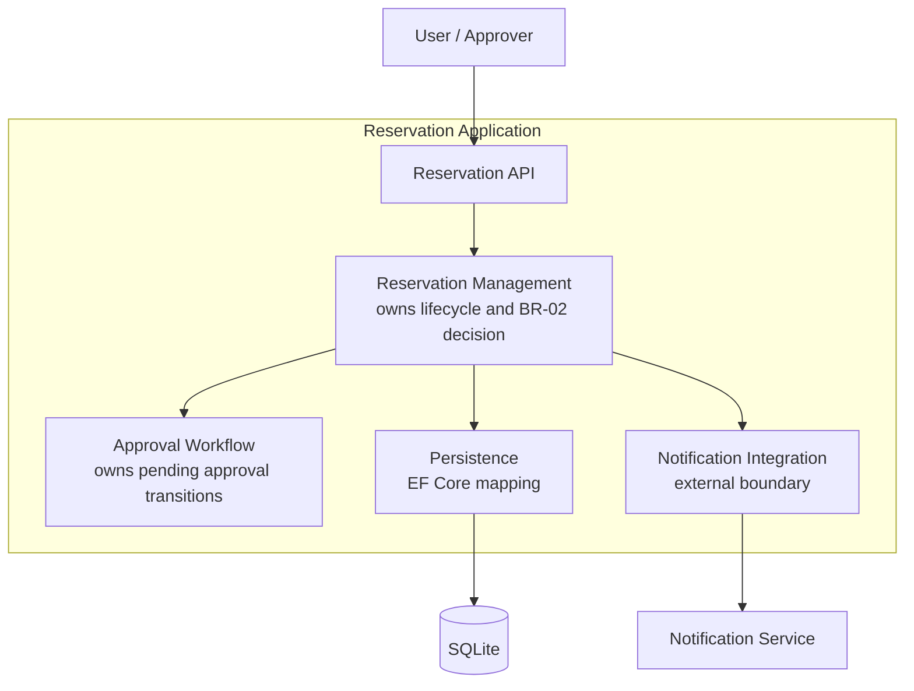
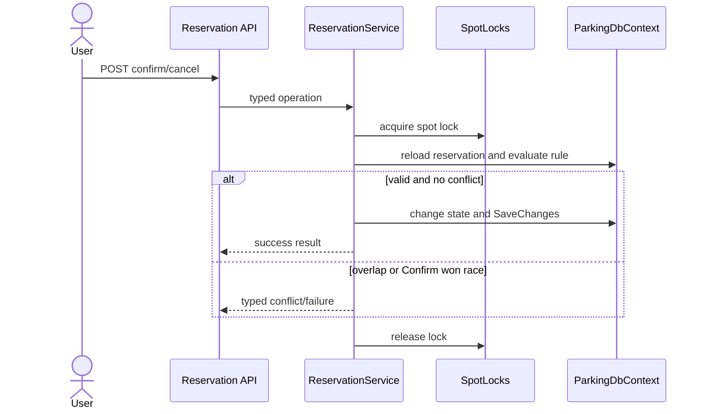

# Architecture and Decisions

## ADR-001: Backend stack

**Decision:** The backend is built on ASP.NET Core Web API (.NET 8), with Entity Framework Core and SQLite as the database.

**Why:**
- .NET 8 is the LTS SDK currently installed in the team's environment (.NET 9 is not available yet).
- EF Core + SQLite allows a quick start without managing an external database server, while the EF Core abstraction stays the same when moving to another SQL engine later (e.g. PostgreSQL).
- Swagger/OpenAPI is part of the default template and makes manual endpoint testing easy without a frontend layer.

**Status:** Historical C01 decision. The current implementation uses the selected stack and now contains the reservation, user, parking-area, and spot models.

## ADR-002: Frontend

**Decision:** The frontend is not addressed yet; the `frontend/` folder is prepared as a placeholder.

**Why:** the team has not agreed on a technology/framework yet; the C01 priority is the backend domain and data model.

**Status:** open — to be completed once a decision is made.

## ADR-003: Reservation persistence (result of spike A)

**Decision:** The DB schema is managed through EF Core migrations; the reservation state is stored as text; times are in UTC; the `parking.db` file is not committed.

**Why:** spike A (see [evidence-and-evolution.md](evidence-and-evolution.md)) verified that storing and reloading a `Reservation` through EF Core + SQLite works, including migrations. Text in the `State` column is easier to read when inspecting the DB manually than an enum number.

**Status:** Partially superseded. Reservation/spot persistence, a `ParkingSpot` foreign key, user persistence, and overlap checks are implemented. Parking-area scope and production authorization are now represented by the current implementation, while external identity remains out of scope.

## ADR-004: Confirm/Cancel concurrency (OP-03, OP-04)

**Decision:** `ReservationService` serializes Confirm and Cancel through `SpotLocks` — an in-memory `SemaphoreSlim` per `ParkingSpot.Id`. "Current time" goes through `IClock` (not `DateTime.UtcNow` directly), so tests can control time deterministically.

**Why:** REQ-04 and BR-03 require that at most one of concurrent requests for the same spot wins. For C02 a lock within one process is sufficient — verified by a test with two truly parallel `Task`s.

**Status:** Implemented for the single-instance baseline. It functions only inside one application instance/database; multi-instance deployment still needs a database-authoritative strategy. The current branch additionally rejects a stale Cancel after Confirm has persisted first.

## ADR-005: Approval workflow (OP-05, v0.2)

**Decision:** `ParkingSpot.RequiresApproval` (bool) decides whether Confirm (OP-03) leads directly to `CONFIRMED` or to `PENDING_APPROVAL`. Expiry of the approval window (REQ-08) is handled lazily — checked on every subsequent access to the reservation (Approve/Reject/Cancel), not by a timer/background job. The window length is configurable (`Reservations:ApprovalWindowHours` in `appsettings.json`), 24 h by default.

**Why:** The C02 assignment explicitly does not want architectural optimization at this stage ("do not solve the ideal architecture yet"). Lazy evaluation is the simplest way to demonstrate the observable behavior (REQ-08) without building a scheduler subsystem.

**Status:** Implemented as a lazy access-time policy with a 24-hour configuration placeholder. A production timer/scheduler and final business duration remain open decisions.

## ADR-007: Parking spot state and occupancy (v0.2.1)

**Decision:** `ParkingSpot.State` stores only the operational and physical state (`Free`, `Occupied`, `OutOfService`). `IsActive` is not a separate column but a derived property `State != OutOfService` (BR-06). `Reserved` is not stored: availability and the reported state for an interval are computed from `CONFIRMED` reservations by one method, `IsSpotAvailableAsync`, for both OP-02 and the area. Occupancy is bound to a specific reservation through `Reservation.CheckedInAt` (BR-07). Check-out moves the reservation to `Completed`. Check-in/out and spot operability changes run under the same `SpotLocks` lock as Confirm.

**Why:** the internal audit of 27 Nov 2026 showed that a global spot state set by Confirm contradicts a time-bound allocation. Cancelling one reservation released the spot for another one too, and a pending request locked the spot forever. Two independent "active" flags (`IsActive` vs. `OutOfService`) also meant that an out-of-service spot could be reserved. The alternative "derive Occupied purely from reservations as well" was rejected: physical presence is a fact entered by the manager, not something derived from time.

**Status:** Implemented (PR `fix/spot-state-audit`), migration `SpotStateSingleSourceAndCheckIn` with backfill, tests `SpotStateConsistencyTests`. Limitation: overstay after `end` is not modelled.

## C03 — Architecture Evidence

### Part A — AS-IS Confirm Reservation

Baseline: v0.2. Scenario: OP-03 Confirm Reservation. Rules: BR-01, BR-02, BR-05. Requirements: REQ-03 and REQ-04.

| Scenario step | Current implementation | Evidence |
|---|---|---|
| Accept confirmation request | Minimal API endpoint binds `ConfirmReservationRequest` and calls the service | `backend/Program.cs`, `MapPost("/reservations/{id:int}/confirm")` |
| Load reservation | `ReservationService` loads by id before acquiring the spot lock | `ReservationService.ConfirmReservationAsync` |
| Serialize decision | `SpotLocks` provides one `SemaphoreSlim` per `ParkingSpot.Id`; the entity is reloaded after the lock | `backend/Services/SpotLocks.cs`, `ReservationService.ConfirmReservationAsync` |
| Validate state, time, and spot activity | Service checks `Draft`, server clock, and `ParkingSpot.IsActive` | `ReservationService.ConfirmReservationAsync`, `IClock` |
| Apply approval branch | `RequiresApproval` changes `Draft` to `PendingApproval`; overlap is deferred | `ReservationService.ConfirmReservationAsync` |
| Enforce BR-02 | Non-approval confirmation queries overlapping `Confirmed` reservations using `[start,end)` predicates | `ReservationService.ConfirmReservationAsync` |
| Persist result | Service changes `Reservation.State` and calls `SaveChangesAsync` | `ReservationService.ConfirmReservationAsync`, `ParkingDbContext` |

Important failure branch: an overlap is detected inside the spot lock, the service returns `ConfirmReservationError.Overlap`, and the reservation remains `Draft`. This is covered by `Confirm_rejected_when_overlaps_existing_confirmed_reservation`.

State is persisted in `Reservations.State` as text through EF Core. `ReservationService` owns the lifecycle decision; `ParkingDbContext` owns persistence mapping. `SpotLocks` is the current concurrency boundary, but it protects only one process.

```mermaid
flowchart LR
	API[Reservation API\nProgram.cs] -->|confirm(id, userId)| Service[ReservationService\nstate, time, approval, overlap]
	Service -->|acquire/release| Locks[SpotLocks\nper-spot SemaphoreSlim]
	Service -->|load/save Reservation| DB[(SQLite\nParkingDbContext)]
	Service -->|read UTC time| Clock[IClock]
```

Architecture question: how should the confirmation decision and BR-02 enforcement remain authoritative when more than one application instance handles requests?

### Drivers, responsibilities, and alternatives

| Source | Driver | Architectural question |
|---|---|---|
| BR-02, REQ-04, Part A | Concurrent confirmations must not create overlapping confirmed reservations | Where is the authoritative allocation decision made? |
| ADR-004, future pressure Q | In-memory locks do not coordinate multiple application instances | What persistence or distributed boundary protects the invariant at scale? |
| BR-05, REQ-08 | Approval state survives the initiating request and may expire later | Who owns pending approval and expiration? |
| Notification boundary, specification TBD | Notification failure semantics are undecided | Is notification best effort, transactional, or retried independently? |

**Decision question:** Where should the authoritative confirmation/approval decision be enforced under concurrency?

**Alternative A — application-process serialization:** retain `SpotLocks` and one deployable. It is simple and matches the current C02 evidence, but it is correct only within one process.

**Alternative B — database-authoritative allocation:** move final conflict protection into a database transaction/constraint strategy, with application locks treated as an optimization. This coordinates multiple instances but requires provider-specific interval and failure handling.

| Driver | Alternative A | Alternative B |
|---|---|---|
| Single-instance correctness | Directly verified by current tests | Also possible, with more machinery |
| Multi-instance correctness | Not sufficient | Can be authoritative across instances |
| Operational complexity | Low | Higher migration and transaction complexity |
| Approval and notification evolution | Remains in one service | Can later separate workers without moving the invariant |

**ADR-006 — Authoritative reservation allocation:** retain `ReservationService` as lifecycle owner and keep `SpotLocks` for the current single-instance baseline. Reopen this decision before multi-instance deployment or when Q becomes an actual operating requirement; then introduce a database-authoritative concurrency mechanism.

Accepted consequence: the current implementation is not a multi-instance solution. This is documented rather than hidden as a quality claim.

### TO-BE views and ownership

For the current scope, the accepted TO-BE remains one Reservation Application process containing Reservation Management, Approval Workflow, Persistence, and Notification Integration boundaries. `ReservationService` owns lifecycle transitions; `SpotLocks` owns process-local serialization; `ParkingDbContext` owns persistence mapping; Notification Integration is reserved for future external delivery.



Runtime mapping: all four logical elements currently run in the ASP.NET Core process; SQLite is the persistence runtime; Notification Service is not integrated in the current code. The design sequence is the Part A call path, with an alternative branch for overlap rejection.

### AS-IS → TO-BE delta

| Area | AS-IS | TO-BE | Action |
|---|---|---|---|
| Reservation lifecycle | `ReservationService` owns transitions | Same owner, explicit in evidence | KEEP |
| Confirm/Cancel race | Process-local lock plus state-aware conflict rejection | Same single-instance rule | KEEP |
| Multi-instance allocation | Not protected across processes | Database-authoritative mechanism required before scaling | VERIFY |
| Approval expiry | Lazy check on access | Same C02 behavior; scheduler remains future work | KEEP |
| Notification Service | Boundary documented, no integration | Isolated integration element when implemented | VERIFY |

### Architecture conformance rule

Rule: only `ReservationService` may assign `Reservation.State` or `ParkingSpot.State` during application operations (OP-01–OP-07). The repeatable check is `bash scripts/check-architecture-conformance.sh`. Since v0.2.1 it scans all of `backend/` except migrations and build output and matches member assignments (`x.State = ...`), not comparisons. A planted assignment outside the service makes it fail with exit code 1 (verified manually). Direct state setup appears only in tests and migrations.

## C05 — Detailed Design

Selected unit: `ReservationService`, focused on `ConfirmReservationAsync` and `CancelReservationAsync`.

Detailed responsibilities:

1. Validate request identity and reservation existence.
2. Serialize same-spot lifecycle decisions.
3. Reload state after lock acquisition.
4. Enforce state, time, activity, approval, and interval rules.
5. Persist exactly one accepted transition and return a typed result.

| Responsibility | Owner | State/data | Contract boundary |
|---|---|---|---|
| Lifecycle decision | `ReservationService` | `Reservation.State` | typed result records |
| Current time | `IClock` | UTC instant | `UtcNow` |
| Same-spot serialization | `SpotLocks` | per-spot semaphore | `Get(spotId)` |
| Persistence | `ParkingDbContext` | Reservations/ParkingSpots | EF Core DbContext |

**Confirm contract:** preconditions are an existing `Draft`, authorized positive user id, `now < start`, active spot, and no overlap unless approval is required. Success is `Confirmed` or `PendingApproval`; failures leave the reservation unchanged. The side effect is one persisted state transition.

**Cancel contract:** an independently initiated cancel may move `Draft`, `Confirmed`, or `PendingApproval` to `Cancelled` before start; an already cancelled reservation is idempotent. If the request observed `Draft` and Confirm has persisted `Confirmed` before the locked reload, Cancel returns `Conflict` and does not perform a second transition.

### DD-derived verification

| DD decision | Test evidence | Level |
|---|---|---|
| `Draft` confirms on an active spot | `Confirm_draft_on_active_spot_without_overlap_succeeds` | component |
| BR-02 rejects overlap | `Confirm_rejected_when_overlaps_existing_confirmed_reservation` | component |
| BR-01 permits touching boundaries | `Confirm_succeeds_when_intervals_only_touch_at_boundary` | component |
| inactive spots cannot confirm | `Confirm_rejected_on_inactive_spot` | component |
| stale Cancel cannot follow a winning Confirm | `Cancel_rejected_when_confirm_persisted_after_cancel_read` | component |
| state changes persist through EF Core | `Reservation_state_change_is_persisted` | integration |


