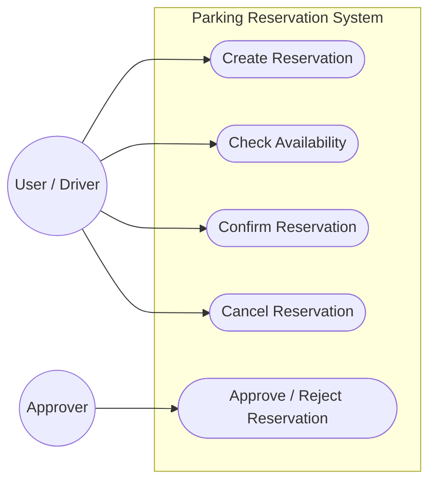
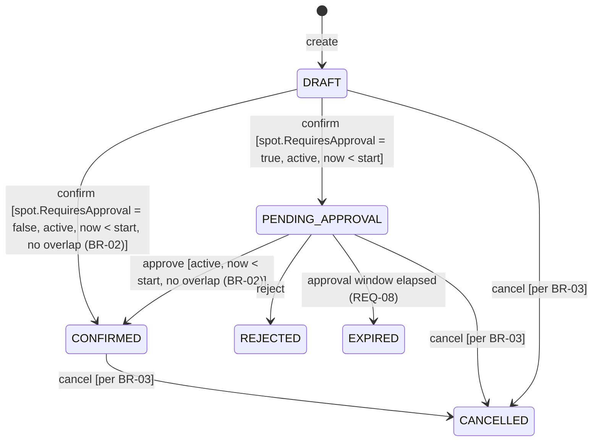
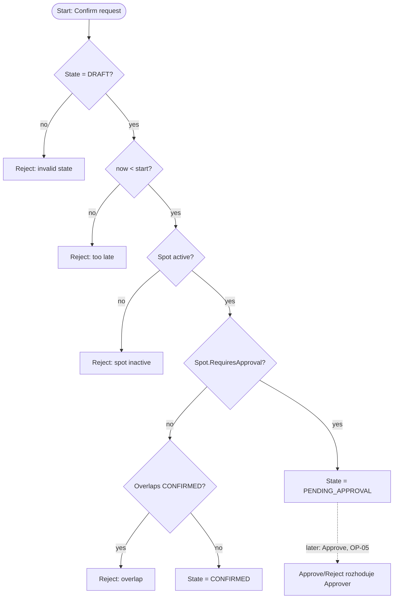
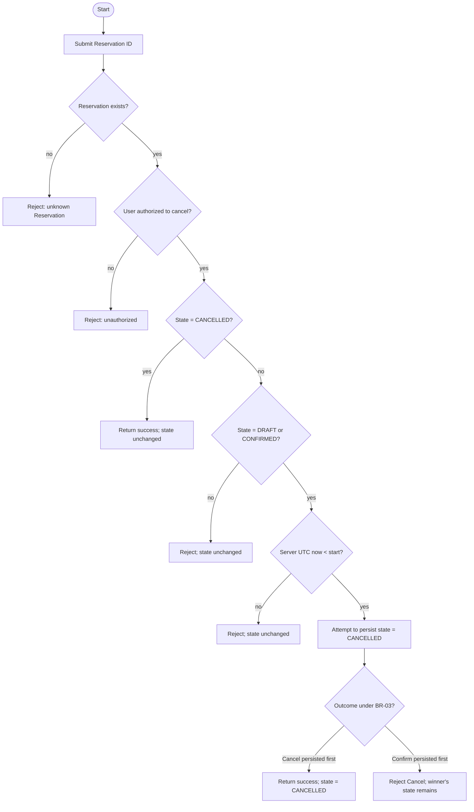

# Parking Reservation System — Specification

Stav: **DRAFT — čeká na schválení týmem jako Baseline v0.1** (sekce 10 kontroly konzistence níže).

Domain reference: [intent-and-change.md](intent-and-change.md) (Project Frame z C01).

---

## 0. Rozhodnutí přijatá před psaním operací

> Odsouhlaseno týmem (2026-10-02).

**Resource:** `ParkingSpot` je **exkluzivní** resource — v jednom okamžiku na něm může být nejvýše jedna `CONFIRMED` rezervace (ne kapacitní sdílení).

**Cancellation policy (BR-03):**
`DRAFT` nebo `CONFIRMED` rezervaci lze zrušit kdykoliv před `Reservation.start` (porovnává se proti serverovému UTC času). Pokus o zrušení již `CANCELLED` rezervace je idempotentní úspěch (zůstává `CANCELLED`, žádná chyba). Pokud `start` nastal nebo uplynul, Cancel je odmítnut. Pokud se `Cancel` a `Confirm` potkají současně na téže rezervaci, vyhrává ten požadavek, který se zapíše do databáze jako první (řeší se transakcí/optimistickým zámkem v architektuře C03 — zde jen definujeme pozorovatelný výsledek: nejvýše jeden z nich uspěje).

**Časová osa:** veškeré časy (`start`, `end`, `currentTime`) jsou UTC (navazuje na ADR-003 z C01).

---

## 1. Doménová pravidla a invarianty (BR)

> Definováno jednou, operace na tato pravidla jen odkazují.

### BR-01 — Interval semantics
Reservation intervals use `[start,end)` semantics (konec intervalu je exkluzivní).

### BR-02 — Exclusive Resource invariant
At no committed system state may two `CONFIRMED` Reservations overlap for the same `ParkingSpot`.

### BR-03 — Cancellation policy
A `DRAFT`, `CONFIRMED`, or `PENDING_APPROVAL` (v0.2) Reservation may be cancelled any time before `Reservation.start` (server UTC time). Cancelling an already `CANCELLED` Reservation is an idempotent success. A Reservation whose `start` has been reached or passed cannot be cancelled. A Reservation in a terminal non-cancelled state (`REJECTED`, `EXPIRED` - v0.2) cannot be cancelled either, since there is nothing left to withdraw. If `Cancel` and `Confirm`/`Approve` race on the same Reservation, at most one of them succeeds (whichever is persisted first).

### BR-04 — Domain-specific rule from C01
Rezervaci `ParkingSpot` typu `EV_CHARGING` nebo `DISABLED` smí vytvořit pouze uživatel, jehož vozidlo/oprávnění odpovídajícímu typu skutečně odpovídá (elektromobil, ZTP průkaz) — ověřuje se při `Create Reservation`. (Převzato z [intent-and-change.md](intent-and-change.md).)

### BR-05 — Approval gate (v0.2)
A Reservation on a `ParkingSpot` with `RequiresApproval = true` can reach `CONFIRMED` only via `Approve` (OP-05), never directly via `Confirm` (OP-03). A Reservation on a `ParkingSpot` with `RequiresApproval = false` is unaffected and confirms directly, as in v0.1.

---

## 2. Operace

### OP-01 — Create Reservation

```
Goal / user value:
Driver creates a reservation request for a ParkingSpot that can later
be confirmed.

Trigger:
Authorized User (driver) requests a Reservation for ParkingSpot S and
interval I.

Observable requirement:
REQ-01:
The system shall create a DRAFT Reservation for an existing ParkingSpot
when the requested interval is valid and, if the spot type requires it
(EV_CHARGING or DISABLED), the requesting user/vehicle satisfies BR-04.

Preconditions:
- User is authorized to create Reservations.
- ParkingSpot exists.
- start < end (BR-01).
- If ParkingSpot.Type is EV_CHARGING or DISABLED, the user/vehicle
  satisfies BR-04.

Success postcondition:
- one new Reservation exists;
- Reservation.state = DRAFT;
- no ParkingSpot allocation is committed yet (BR-02 only constrains
  CONFIRMED reservations).

State change:
[none] → DRAFT

Referenced rules:
BR-01, BR-04

Main success scenario:
1. User submits ParkingSpot id, interval, and (if relevant) vehicle info.
2. System validates authorization, ParkingSpot existence, interval
   validity and BR-04 eligibility.
3. System creates Reservation in DRAFT.
4. System returns the Reservation identifier and current state.

Alternative / failure outcomes:
- unauthorized User → reject; no Reservation created;
- unknown ParkingSpot → reject; no Reservation created;
- invalid interval (start >= end) → reject; no Reservation created;
- EV_CHARGING/DISABLED spot requested without matching vehicle/permit
  → reject (BR-04); no Reservation created.

Verification examples:
valid STANDARD ParkingSpot + [10:00,11:00) → one DRAFT created
start == end → rejected
unknown ParkingSpot id → rejected
EV_CHARGING spot + non-electric vehicle → rejected

Rationale:
Creation records driver intent without committing spot allocation;
BR-04 eligibility depends on static vehicle/user attributes, not on
concurrent reservations, so it is checked here rather than at Confirm.

Assumption / unknown / TBD:
TBD — zdroj informace "vozidlo je elektromobil / má ZTP" (součást
požadavku na vytvoření, nebo profil uživatele?) zatím není určen.
```

### OP-02 — Check Availability

```
Goal / user value:
User can determine whether a ParkingSpot is available for a requested
interval before attempting to reserve it.

Trigger:
User requests availability of ParkingSpot S for interval I.

Observable requirement:
REQ-02:
The system shall report a ParkingSpot as unavailable if the ParkingSpot
is not active, or if the interval overlaps any CONFIRMED Reservation of
that ParkingSpot; otherwise, for a valid interval, it shall report it as
available.

Preconditions:
- ParkingSpot exists.
- requested interval is valid (BR-01).

Success postcondition:
- availability result is returned;
- no Reservation state is changed.

Referenced rules:
BR-01, BR-02

Verification examples:
Existing CONFIRMED: [10:00,11:00)

query [09:00,10:00) → AVAILABLE
query [10:30,11:30) → UNAVAILABLE
query [11:00,12:00) → AVAILABLE
inactive ParkingSpot, no reservations at all → UNAVAILABLE

Accepted semantics:
Intervals are half-open: [start,end).

Rationale:
A ParkingSpot that is not active (OUT_OF_SERVICE) is never offered as
available, regardless of its reservations — consistent with the
invariant from C01 (docs/intent-and-change.md) and with OP-03, which
also rejects Confirm on an inactive ParkingSpot. Create (OP-01)
deliberately stays unaffected: it only records intent and does not
allocate, so it is still allowed on an inactive ParkingSpot.

Assumption / unknown / TBD:
DRAFT reservations do not block availability — only CONFIRMED ones do
(plyne z BR-02 a z toho, že OP-01 ještě neallokuje spot).
```

### OP-03 — Confirm Reservation

```
Goal / user value:
A valid DRAFT Reservation becomes the accepted allocation of the
ParkingSpot.

Trigger:
Authorized User requests confirmation of Reservation X.

Observable requirements:
REQ-03:
The system shall confirm a DRAFT Reservation only when its ParkingSpot is
active and its interval does not overlap any existing CONFIRMED
Reservation of the same ParkingSpot.

REQ-04 (concurrency):
For concurrent confirmation attempts that conflict under BR-02, at most
one Reservation shall reach CONFIRMED; the others are rejected and remain
DRAFT.

Preconditions:
- Reservation X exists.
- Reservation X.state = DRAFT.
- User is authorized to confirm Reservation X.
- current time < Reservation X.start (server UTC time).

Success postcondition:
- Reservation X.state = CONFIRMED;
- Reservation X blocks its ParkingSpot for [start,end) (BR-01);
- BR-02 remains true.

State change:
DRAFT → CONFIRMED

Referenced rules:
BR-01 (interval semantics [start,end)), BR-02 (exclusive ParkingSpot).

Main success scenario:
1. User submits the Reservation identifier.
2. System loads Reservation X and verifies authorization, that
   state = DRAFT and that current time < start.
3. System verifies that the ParkingSpot of Reservation X is active.
4. System verifies that the interval of Reservation X does not overlap
   any CONFIRMED Reservation of the same ParkingSpot (BR-01, BR-02).
5. System sets Reservation X.state = CONFIRMED.
6. System returns the Reservation identifier and current state.

Failure outcomes:
- unknown Reservation → reject; nothing changes;
- unauthorized User → reject; state unchanged;
- state ≠ DRAFT (including already CONFIRMED or CANCELLED) → reject;
  state unchanged;
- start reached or passed → reject; state unchanged;
- ParkingSpot not active → reject; Reservation remains DRAFT;
- interval overlaps an existing CONFIRMED Reservation of the same
  ParkingSpot → reject; Reservation remains DRAFT;
- concurrent conflicting confirmations → exactly one succeeds, the others
  are rejected and remain DRAFT;
- concurrent Confirm and Cancel on the same Reservation → exactly one of
  them takes effect (BR-03); the Reservation is never both CONFIRMED and
  CANCELLED.

Verification examples:
DRAFT + active ParkingSpot + no overlap → CONFIRMED
Existing CONFIRMED [10:00,11:00), DRAFT [10:30,11:30) → rejected, DRAFT
Existing CONFIRMED [10:00,11:00), DRAFT [11:00,12:00) → CONFIRMED
  (boundary only touches, BR-01)
DRAFT on inactive ParkingSpot → rejected, DRAFT
Confirm an already CONFIRMED Reservation → rejected, state unchanged
DRAFT with start in the past (start <= current time) → rejected, state
  unchanged
Concurrent Confirm and Cancel on the same DRAFT → exactly one takes
  effect; final state is either CONFIRMED or CANCELLED, never both
Two concurrent conflicting DRAFTs on the same ParkingSpot → exactly one
  CONFIRMED, the other rejected and DRAFT
Two concurrent DRAFTs on different ParkingSpots → both CONFIRMED

Acceptance check:
- Meaning: confirmation commits the allocation of the ParkingSpot for
  [start,end).
- Observable result: the returned state is CONFIRMED on success; on
  rejection the Reservation is observably still DRAFT (or unchanged).
- State/time: only DRAFT → CONFIRMED is possible, and only before
  start; intervals are [start,end), so touching boundaries do not
  conflict.
- Concurrency: for conflicting concurrent attempts at most one reaches
  CONFIRMED.
- Consistency: after any outcome BR-02 holds (no two overlapping
  CONFIRMED Reservations on one ParkingSpot).

Rationale:
The allocation is committed only at Confirm (Create does not allocate),
so exclusivity of the ParkingSpot is checked here; concurrency is a
business outcome, not just an implementation detail.

Assumption / unknown / TBD:
TBD — who may confirm (the owner of the Reservation, an admin, or both);
"authorized" is not yet defined.
Assumption — Confirm is rejected once Reservation.start has been reached
or passed (consistent with BR-03 time semantics; decided in this
revision).
TBD — source of "current time" (server clock assumed, UTC); clock
accuracy/synchronization is not specified.
TBD — whether failure of the Notification Service cancels the confirm or
is best-effort (confirm stays valid).
TBD — which of several conflicting concurrent confirmations wins; only
"at most one" is specified, no fairness/ordering rule is defined.
Concurrent Confirm vs. Cancel is governed by BR-03 (at most one of them
succeeds); no further TBD here, OP-04 must stay consistent with it.
Assumption — "ParkingSpot is active" is a ParkingSpot attribute; its
definition and who changes it are not specified yet.
```

### OP-04 — Cancel Reservation

```
Goal / user value:
User can cancel a Reservation before its start, preventing a DRAFT from
being confirmed or releasing a CONFIRMED allocation.

Trigger:
Authorized User requests cancellation of Reservation X.

Observable requirement:
REQ-05:
The system shall transition a DRAFT or CONFIRMED Reservation to CANCELLED
when an authorized cancellation request is made before Reservation.start
(server UTC time). A request to cancel an already CANCELLED Reservation
shall succeed without changing its state. Cancellation at or after start
shall be rejected. If Confirm and Cancel race on the same Reservation, at
most one of them succeeds (BR-03).

Preconditions:
- Reservation X exists.
- User is authorized to cancel Reservation X (the authorization scope is
  not yet defined).
- For a non-CANCELLED Reservation, current time < Reservation.start
  (server UTC time); otherwise the request is rejected per BR-03.

Success postcondition:
- For a DRAFT or CONFIRMED Reservation, Reservation X.state = CANCELLED.
- The cancelled Reservation no longer blocks its ParkingSpot as a
  CONFIRMED Reservation (BR-02).
- For an already CANCELLED Reservation, the request succeeds and the
  state remains CANCELLED (idempotent; BR-03).

State change:
DRAFT → CANCELLED
CONFIRMED → CANCELLED
CANCELLED → CANCELLED (idempotent success; no state change)

Referenced rules:
BR-02, BR-03

Main success scenario:
1. User submits the Reservation identifier.
2. System loads Reservation X and verifies the user's authorization.
3. If Reservation X is already CANCELLED, the system returns success with
   its current state and makes no state change.
4. Otherwise, the system verifies that Reservation X is DRAFT or
   CONFIRMED and that current time < Reservation X.start.
5. The system persists Reservation X.state = CANCELLED. If Confirm and
   Cancel race on X, only the request persisted first succeeds (BR-03).
6. System returns the Reservation identifier and current state.

Failure outcomes:
- unknown Reservation → reject; nothing changes;
- unauthorized User → reject; state unchanged;
- Reservation.start reached or passed for a non-CANCELLED Reservation →
  reject; state unchanged;
- a concurrent Confirm request was persisted first → reject this Cancel
  request; no second transition occurs, and the winner determines the
  resulting state (BR-03).

Verification examples:
DRAFT + current time < start → CANCELLED
CONFIRMED + current time < start → CANCELLED; no longer blocks the spot
CANCELLED + current time >= start → success; remains CANCELLED
DRAFT or CONFIRMED + current time >= start → rejected; state unchanged
Concurrent Confirm and Cancel on the same Reservation → at most one
  succeeds; the final state is CONFIRMED or CANCELLED, never both

Rationale:
Cancellation is an explicit state transition rather than deletion.
Idempotent success for an already CANCELLED Reservation makes a repeated
request safe, while BR-03 prevents cancellation once the reserved interval
has started.

Assumption / unknown / TBD:
TBD — who is authorized to cancel (the Reservation owner, an admin, or
both) is not defined here.
TBD — whether cancellation sends a notification and how Notification
Service failure affects the result.
```

### OP-04 — Cancel Reservation *(dodatek pro v0.2)*

Text výše (v0.1) zůstává platný; `PENDING_APPROVAL` se do něj přidává stejně jako `DRAFT`/`CONFIRMED`, `REJECTED`/`EXPIRED` jsou nově vyloučené (nejde je zrušit):

```
REQ-05 (v0.2 dodatek):
The system shall also transition a PENDING_APPROVAL Reservation to
CANCELLED under the same condition (current time < start), per BR-03.
A Reservation in state REJECTED or EXPIRED cannot be cancelled - the
request is rejected as an invalid source state (there is no pending
allocation or request left to withdraw).

State change (v0.2 dodatek):
PENDING_APPROVAL → CANCELLED

Verification examples (v0.2 dodatek):
PENDING_APPROVAL + current time < start → CANCELLED
REJECTED or EXPIRED (any time) → rejected; invalid source state
```

---

## 3. Diagramy

### 3a. Use case diagram (aktéři a cíle) — v0.2



v0.2 dodatek: přibyl aktér **Approver** a cíl **Approve / Reject Reservation** (OP-05). Ostatní cíle a aktér Driver jsou beze změny oproti v0.1.

### 3b. Stavový diagram Reservation — v0.2



Poznámky:
- Ze stavů `CONFIRMED`, `CANCELLED`, `REJECTED`, `EXPIRED` nevede žádný přechod `confirm`/`approve`/`reject`; takové požadavky jsou odmítnuty (OP-03/OP-05).
- Zamítnutý `confirm`/`approve` (neaktivní spot, překryv, souběh, start již nastal nebo uplynul) stav nemění — Reservation zůstává v původním stavu (`DRAFT`, resp. `PENDING_APPROVAL`).
- `cancel` už `CANCELLED` rezervace je idempotentní úspěch bez změny stavu (BR-03); `cancel` na `REJECTED`/`EXPIRED` je odmítnut (BR-03 v0.2 - nic k vzetí zpět).
- `REJECTED` a `EXPIRED` jsou terminální - nevede z nich žádný další přechod.
- v0.1 (bez `RequiresApproval`) odpovídá přesně hraně `DRAFT --> CONFIRMED` nahoře — nic se pro tyto spoty nemění.

### 3d. Diagram aktivit — Confirm/Approve větvení (v0.2)



### 3c. Diagram aktivit



The use-case actor covers the user goals in OP-01 through OP-04; operation
authorization requirements and the still-undefined cancellation scope are
specified in the operation text.

The activity diagram shows the idempotent path before the start-time check:
an already CANCELLED Reservation succeeds without a state change, as
required by BR-03. A competing Confirm that is persisted first causes the
Cancel request to be rejected (BR-03).

---

## 4. Kontrola konzistence (bod 10 ze zadání)

| Kontrola | Stav | Poznámka |
|---|---|---|
| Create vs. Confirm | ☑ | Create (OP-01) nikdy nealokuje spot (žádná kontrola overlapu); exkluzivita (BR-02) se vynucuje až při Confirm (OP-03). Konzistentní. |
| Availability vs. Confirm | ☑ | **Vyřešeno (odsouhlaseno týmem 2026-10-11):** REQ-02 nově zohledňuje `ParkingSpot.IsActive` stejně jako OP-03 — neaktivní spot je vždy `UNAVAILABLE`, bez ohledu na rezervace. Create (OP-01) zůstává beze změny, protože jen zaznamenává záměr a nic nealokuje. |
| Cancel vs. stavový diagram | ☑ | OP-04 state changes match BR-03 and section 3b. |
| Význam intervalů napříč operacemi | ☑ | OP-01, OP-02, OP-03 důsledně používají `[start,end)` (BR-01); hraniční příklad v OP-03 (dotyk v 11:00) odpovídá OP-02. |
| Use-case diagram vs. text | ☑ | The diagram covers the user goals in OP-01 through OP-04. |
| Požadavek vs. návrhové rozhodnutí | ☑ | Žádný požadavek nepředepisuje implementaci/technologii (DB, framework) — jen pozorovatelné chování. |
| Nejistota vs. vymyšlená přesnost | ☑ | Nejasné body (autorizace, Notification Service, přesnost hodin, fairness při souběhu) jsou všude explicitně označené jako Assumption/TBD, ne vymyšlené natvrdo. |

**Schváleno jako Specification Baseline v0.1:** ☑ ano / datum: 11.10.2026 / kým: Jan Ječmínek

---

## 5. Část B — Změna: schvalovací proces

> **Draft — navrhl AI, čeká na schválení týmem** (stejně jako sekce 0 u v0.1). Rozhodnutí níže jsou odůvodněná, ale jsou to návrhy, ne hotová fakta — než zaškrtnete schválení v0.2 na konci této sekce, projděte je.

**Změna C02 (zadání):** Některé Resources vyžadují schválení oprávněnou osobou dříve, než se Reservation může stát CONFIRMED. Schválení může být opožděno, zamítnuto nebo může vypršet.

**Klíčová rozhodnutí (navrženo):**
- Které ParkingSpot vyžadují schválení je dáno novým atributem `ParkingSpot.RequiresApproval` (bool), nezávislým na `Type` — "některé", ne celá kategorie.
- Pro spot **bez** `RequiresApproval` se nic nemění — Confirm (OP-03) funguje přesně jako ve v0.1.
- Pro spot **s** `RequiresApproval` se Confirm nerozděluje na novou operaci "požádat o schválení" — zůstává to stále Confirm (stejný trigger, stejný formulář), jen jeho výsledkem při `RequiresApproval = true` není rovnou `CONFIRMED`, ale `PENDING_APPROVAL`. Nově vzniká **OP-05 Approve Reservation**, kterou provádí nový aktér (Approver), a teprve ta vede k `CONFIRMED` nebo `REJECTED`.

### Analýza dopadu (bod 12)

| Oblast | Odpověď |
|---|---|
| Create | Beze změny. Create pořád jen zaznamenává záměr (DRAFT) a `RequiresApproval` flag spotu při Create vůbec nekontroluje — ten hraje roli až při Confirm. |
| Availability | Beze změny v logice, jen nová úvaha: `PENDING_APPROVAL` **neblokuje** dostupnost, stejně jako `DRAFT` dnes neblokuje — blokuje jen `CONFIRMED` (BR-02). Důvod: schválení může být zamítnuto nebo vypršet, takže by bylo špatné dočasně "zamknout" slot jen kvůli čekající žádosti. |
| Confirm | Mění se: již to není vždy okamžitá operace. Pro `RequiresApproval = false` beze změny (→ CONFIRMED). Pro `RequiresApproval = true` → `PENDING_APPROVAL` (bez kontroly overlapu — ta se přesouvá až do Approve, stejnou logikou, jako dnes Create nekontroluje overlap a až Confirm ano). |
| Approve | Vzniká nová operace (OP-05) a nový aktér (Approver/schvalovatel). Kdo přesně smí schvalovat, je TBD (stejně jako "kdo smí confirm/cancel" ve v0.1). |
| Cancel | Rozšiřuje se: `PENDING_APPROVAL` lze zrušit (requester může vzít žádost zpět, než se o ní rozhodne), stejnou podmínkou `now < start` jako dnes u DRAFT/CONFIRMED (BR-03). `REJECTED` a `EXPIRED` jsou nové terminální stavy - cancel na nich je odmítnut (nejsou to "aktivní" rezervace). |
| Stavový diagram | Přibývají stavy `PENDING_APPROVAL`, `REJECTED`, `EXPIRED` a přechody `confirm` (podmíněný `RequiresApproval`), `approve`, `reject`, časové vypršení. Viz upravený diagram 3b níže. |
| Diagram případů užití | Přibývá aktér Approver a cíl "Approve/Reject Reservation". Viz upravený diagram 3a níže. |
| Ověření | Nové verification examples v OP-03 (přesun do PENDING_APPROVAL) a OP-05 (approve/reject/expired). Testováno v `tests/` (viz evidence). |
| Architektura | Expirace vyžaduje znalost "jak dlouho už čekáme" → nové perzistentní pole na Reservation. V C02 řešeno líně (kontrola při každém dotyku rezervace), ne časovačem/joblist — to je architektonický driver pro C03 (viz níže). Approve/Reject navíc posiluje důvod pro Notification Service boundary (upozornit requestera na výsledek, upozornit Approvera na novou žádost). |

### Dopad změny C02 (bod 13)

```
Změněná podmínka:
Některé ParkingSpot (flag RequiresApproval) vyžadují schválení oprávněnou
osobou (Approver), než Reservation dosáhne CONFIRMED; schválení může být
zpožděno, zamítnuto (REJECTED), nebo může vypršet (EXPIRED).

Dotčené požadavky / části specifikace:
- OP-03 (REQ-03): rozšířeno o podmínku RequiresApproval - viz upravený text.
- BR-03 (cancellation policy): rozšířeno o PENDING_APPROVAL jako zrušitelný
  stav.
- Stavový diagram (3b) a use-case diagram (3a): aktualizovány na v0.2.

Nedotčené požadavky / části + proč:
- OP-01 Create: beze změny - Create nerozlišuje RequiresApproval, pořád jen
  zaznamenává záměr jako DRAFT.
- OP-02 Check Availability (REQ-02): beze změny - PENDING_APPROVAL/REJECTED/
  EXPIRED nejsou CONFIRMED, takže do výpočtu dostupnosti nevstupují už podle
  stávajícího znění REQ-02 (jen IsActive + CONFIRMED overlap).
- BR-01 (interval semantics), BR-02 (exclusive resource invariant): beze
  změny - overlap se pořád počítá jen mezi CONFIRMED rezervacemi, jen se
  posouvá okamžik, kdy k němu u schvalovaných míst dochází (Approve místo
  Confirm).
- BR-04 (EV/DISABLED eligibility z C01): beze změny, nezávislé pravidlo.

Nový aktér / operace, pokud vznikne:
- Aktér: Approver (schvalovatel) - oprávněná osoba rozhodující o žádostech
  na spotech s RequiresApproval = true. Přesný rozsah oprávnění je TBD.
- Operace: OP-05 Approve Reservation (zahrnuje i explicitní reject).

Změněná pravidla / význam stavů:
- BR-03 rozšířeno: PENDING_APPROVAL lze zrušit stejnou podmínkou (now <
  start) jako DRAFT/CONFIRMED.
- Nové BR-05 (viz sekce 1): CONFIRMED lze u RequiresApproval spotu dosáhnout
  jen přes Approve, nikdy přímo přes Confirm.
- REJECTED a EXPIRED jsou nové terminální stavy, bez návratu.

Změna diagramu případů užití:
Přidán aktér Approver a cíl "Approve / Reject Reservation" (viz 3a).

Změna stavového diagramu:
Přidány stavy PENDING_APPROVAL, REJECTED, EXPIRED a přechody confirm
(podmíněno RequiresApproval), approve, reject, expirace (viz 3b).

Nové příklady ověření:
- Confirm na RequiresApproval spotu -> PENDING_APPROVAL (ne CONFIRMED).
- Approve úspěšný (aktivní spot, now<start, žádný overlap) -> CONFIRMED.
- Approve s overlapem -> odmítnuto, zůstává PENDING_APPROVAL.
- Reject -> REJECTED (terminální).
- PENDING_APPROVAL po vypršení okna -> EXPIRED při dalším dotyku.
- Cancel na PENDING_APPROVAL před start -> CANCELLED.
- Cancel na REJECTED/EXPIRED -> odmítnuto (neplatný zdrojový stav).

Architektonické drivery pro C03:
- Expirace je teď řešena líným přepočtem při každém sáhnutí na rezervaci,
  ne časovačem - rezervace, na kterou nikdo nesáhne, zůstane "fakticky
  expirovaná, ale formálně PENDING_APPROVAL" v DB, dokud ji něco nenačte.
  Potřeba buď background job, nebo scheduled query (future pressure Q/L).
- Approve/Reject i expirace jsou přirozené body pro napojení Notification
  Service (boundary z C01/intent-and-change.md) - zatím nijak neřešeno.
- SpotLocks (ADR-004) teď musí serializovat i Approve - zůstává v procesu,
  limit pro víc instancí aplikace trvá.
```

### OP-03 — Confirm Reservation *(dodatek pro v0.2, viz text výše v sekci 2)*

Text OP-03 v sekci 2 zůstává platný pro `ParkingSpot.RequiresApproval = false`. Pro `RequiresApproval = true` se REQ-03 mění takto:

```
REQ-03 (v0.2 dodatek):
If the ParkingSpot has RequiresApproval = true, the system shall instead
transition a DRAFT Reservation to PENDING_APPROVAL (not CONFIRMED) when
the ParkingSpot is active and current time < Reservation.start. The
overlap check against other CONFIRMED Reservations (BR-02) is deferred
to OP-05 Approve, not performed here.

Verification examples (v0.2 dodatek):
DRAFT on a RequiresApproval spot, active, now < start -> PENDING_APPROVAL
  (even if another CONFIRMED Reservation already overlaps - the conflict
  is caught later, at Approve)
```

### OP-05 — Approve Reservation

```
Goal / user value:
An authorized Approver decides a PENDING_APPROVAL Reservation on a spot
that requires approval: grant it (become the committed allocation) or
refuse it.

Trigger:
Authorized Approver requests approve or reject of Reservation X.

Observable requirements:
REQ-06 (approve):
The system shall transition a PENDING_APPROVAL Reservation to CONFIRMED
when its ParkingSpot is active, current time < Reservation.start, and its
interval does not overlap any existing CONFIRMED Reservation of the same
ParkingSpot (BR-02). Otherwise the approve request is rejected and the
Reservation remains PENDING_APPROVAL.

REQ-07 (reject):
The system shall transition a PENDING_APPROVAL Reservation to REJECTED
when an authorized Approver explicitly rejects it, regardless of overlap.

REQ-08 (expiry):
A PENDING_APPROVAL Reservation whose approval window has elapsed (exact
duration TBD - see Assumption) shall be treated as EXPIRED on its next
access (approve, reject, or cancel attempt), instead of being approved or
rejected.

Preconditions:
- Reservation X exists.
- Reservation X.state = PENDING_APPROVAL (otherwise: not expired-checked
  from a state this operation cannot act on).
- Approver is authorized (scope TBD).
- For approve: ParkingSpot is active, current time < Reservation.start,
  no overlapping CONFIRMED Reservation of the same ParkingSpot.

Success postcondition (approve):
- Reservation X.state = CONFIRMED;
- Reservation X blocks its ParkingSpot for [start,end) (BR-01, BR-02).

Success postcondition (reject):
- Reservation X.state = REJECTED (terminal, no further transitions).

State change:
PENDING_APPROVAL → CONFIRMED (approve)
PENDING_APPROVAL → REJECTED (reject)
PENDING_APPROVAL → EXPIRED (approval window elapsed, detected lazily)

Referenced rules:
BR-01, BR-02, BR-05

Main success scenario (approve):
1. Approver submits the Reservation identifier and chooses "approve".
2. System loads Reservation X; if its approval window has elapsed,
   transitions it to EXPIRED instead and stops (REQ-08).
3. System verifies Approver authorization and that state = PENDING_APPROVAL.
4. System verifies the ParkingSpot is active and current time < start.
5. System verifies no overlap with an existing CONFIRMED Reservation of
   the same ParkingSpot (BR-02).
6. System sets Reservation X.state = CONFIRMED.
7. System returns the Reservation identifier and current state.

Failure outcomes:
- unknown Reservation → reject; nothing changes;
- unauthorized Approver → reject; state unchanged;
- state ≠ PENDING_APPROVAL (already CONFIRMED/REJECTED/CANCELLED, or
  DRAFT on a non-approval spot) → reject; state unchanged;
- approval window elapsed → Reservation becomes EXPIRED instead (REQ-08);
  the approve/reject request itself is rejected as "no longer pending";
- approve: ParkingSpot not active → reject; stays PENDING_APPROVAL;
- approve: current time ≥ start → reject; stays PENDING_APPROVAL;
- approve: overlaps an existing CONFIRMED Reservation → reject; stays
  PENDING_APPROVAL (requester or Approver must resolve, e.g. via Cancel);
- reject: always succeeds while state = PENDING_APPROVAL and not expired,
  regardless of overlap or ParkingSpot activity.

Verification examples:
PENDING_APPROVAL + active spot + no overlap + approve → CONFIRMED
PENDING_APPROVAL + overlapping CONFIRMED + approve → rejected, stays
  PENDING_APPROVAL
PENDING_APPROVAL + reject → REJECTED
PENDING_APPROVAL + approval window elapsed + approve attempt → EXPIRED
  (not CONFIRMED)
PENDING_APPROVAL + start already passed + approve → rejected, stays
  PENDING_APPROVAL
Already CONFIRMED + approve attempt → rejected (invalid state)

Rationale:
Approve re-checks exactly what Confirm would have checked directly (BR-02,
active spot, timing) because the overlap could only be meaningfully
evaluated once a human decision is imminent; reject needs no such check
because it never commits an allocation. Expiry is checked lazily (on
access) rather than by a background process, consistent with "neoptimalizujte
architekturu v C02" - a real timer/scheduler is an explicit driver for C03.

Assumption / unknown / TBD:
TBD — who is authorized to approve/reject (a specific admin role, the
ParkingSpot's owner/operator, or someone else) is not defined.
TBD — exact approval window duration (how long a PENDING_APPROVAL may
wait before EXPIRED) is not decided; current code uses a placeholder
value for demonstration only, not a business decision.
TBD — whether an expired or rejected Reservation triggers a new DRAFT
automatically, or the requester must start over with a new Create - this
spec assumes the requester must create a new Reservation.
TBD — whether Notification Service failure affects approve/reject
(same open question as already noted in OP-03).
```

### Kontrola konzistence v0.2

| Kontrola | Stav | Poznámka |
|---|---|---|
| Confirm vs. BR-05 | ☑ | OP-03 dodatek přesně odpovídá BR-05: `RequiresApproval = true` jde do `PENDING_APPROVAL`, nikdy přímo do `CONFIRMED`. |
| Approve vs. stavový diagram (3b) | ☑ | Všechny tři přechody z OP-05 (approve→CONFIRMED, reject→REJECTED, expirace→EXPIRED) jsou v diagramu 3b. |
| Cancel vs. rozšířené BR-03 | ☑ | OP-04 má nyní v0.2 dodatek, který `PENDING_APPROVAL` i vyloučení `REJECTED`/`EXPIRED` zapisuje přímo do textu operace, ne jen do BR-03. |
| Use-case diagram vs. OP-05 | ☑ | Aktér Approver a cíl "Approve / Reject Reservation" (3a) odpovídá OP-05. |
| Nejistota vs. vymyšlená přesnost (approval window) | ☑ | Přesná délka okna je explicitně TBD v OP-05, kód používá jen placeholder - žádná vymyšlená "oficiální" hodnota se netváří jako rozhodnutí. |

**Schváleno jako Specification Baseline v0.2:** ☐ ano / datum: _____ / kým: _____
