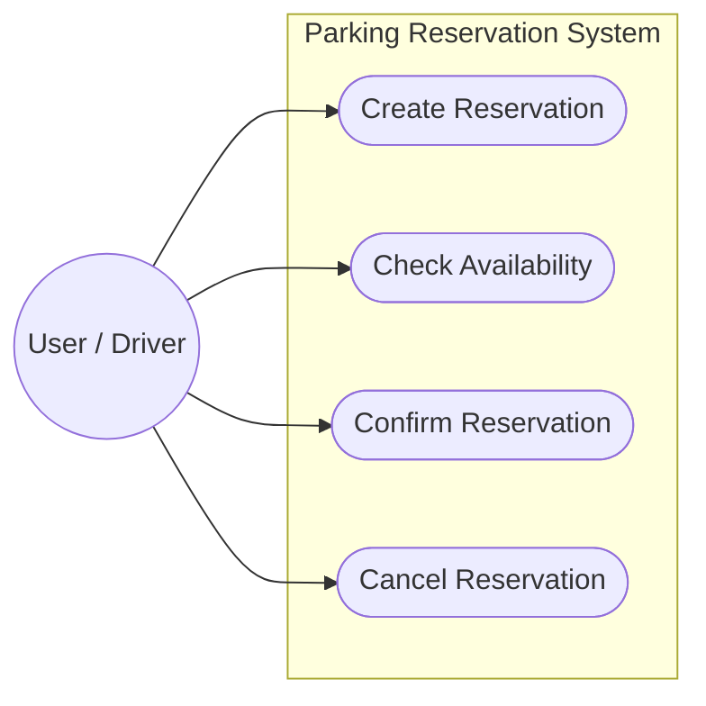
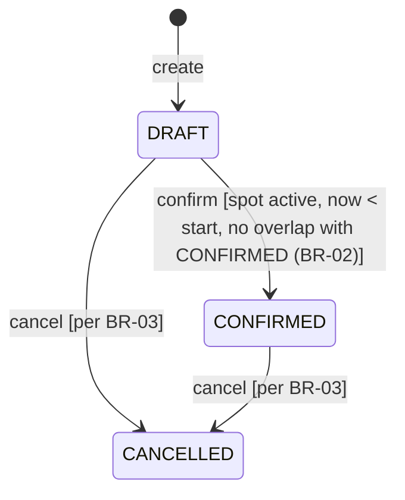

# Parking Reservation System — Specification

Stav: **DRAFT — čeká na schválení týmem jako Baseline v0.1** (sekce 10 kontroly konzistence níže).

Domain reference: [intent-and-change.md](intent-and-change.md) (Project Frame z C01).

---

## 0. Rozhodnutí přijatá před psaním operací

> Odsouhlaseno týmem (2026-10-02).

**Resource:** `ParkingSpot` je **exkluzivní** resource — v jednom okamžiku na něm může být nejvýše jedna `CONFIRMED` rezervace (ne kapacitní sdílení).

**Cancellation policy (BR-03):**
`DRAFT` nebo `CONFIRMED` rezervaci lze zrušit kdykoliv před `Reservation.start` (porovnává se proti serverovému UTC času). Pokus o zrušení již `CANCELLED` rezervace je idempotentní úspěch (zůstává `CANCELLED`, žádná chyba). Pokud `start` nastal nebo uplynul, Cancel je odmítnut. Pokud se `Cancel` a `Confirm` potkají současně na téže rezervaci, vyhrává ten požadavek, který se zapíše do databáze jako první (řeší se transakcí/optimistickým zámkem v architektuře C03 — zde jen definujeme pozorovatelný výsledek: nejvýše jeden z nich uspěje).

**Časová osa:** veškeré časy (`start`, `end`, `currentTime`) jsou UTC (navazuje na ADR-003 z C01).

---

## 1. Doménová pravidla a invarianty (BR)

> Definováno jednou, operace na tato pravidla jen odkazují.

### BR-01 — Interval semantics
Reservation intervals use `[start,end)` semantics (konec intervalu je exkluzivní).

### BR-02 — Exclusive Resource invariant
At no committed system state may two `CONFIRMED` Reservations overlap for the same `ParkingSpot`.

### BR-03 — Cancellation policy
A `DRAFT` or `CONFIRMED` Reservation may be cancelled any time before `Reservation.start` (server UTC time). Cancelling an already `CANCELLED` Reservation is an idempotent success. A Reservation whose `start` has been reached or passed cannot be cancelled. If `Cancel` and `Confirm` race on the same Reservation, at most one of them succeeds (whichever is persisted first).

### BR-04 — Domain-specific rule from C01
Rezervaci `ParkingSpot` typu `EV_CHARGING` nebo `DISABLED` smí vytvořit pouze uživatel, jehož vozidlo/oprávnění odpovídajícímu typu skutečně odpovídá (elektromobil, ZTP průkaz) — ověřuje se při `Create Reservation`. (Převzato z [intent-and-change.md](intent-and-change.md).)

---

## 2. Operace

### OP-01 — Create Reservation

```
Goal / user value:
Driver creates a reservation request for a ParkingSpot that can later
be confirmed.

Trigger:
Authorized User (driver) requests a Reservation for ParkingSpot S and
interval I.

Observable requirement:
REQ-01:
The system shall create a DRAFT Reservation for an existing ParkingSpot
when the requested interval is valid and, if the spot type requires it
(EV_CHARGING or DISABLED), the requesting user/vehicle satisfies BR-04.

Preconditions:
- User is authorized to create Reservations.
- ParkingSpot exists.
- start < end (BR-01).
- If ParkingSpot.Type is EV_CHARGING or DISABLED, the user/vehicle
  satisfies BR-04.

Success postcondition:
- one new Reservation exists;
- Reservation.state = DRAFT;
- no ParkingSpot allocation is committed yet (BR-02 only constrains
  CONFIRMED reservations).

State change:
[none] → DRAFT

Referenced rules:
BR-01, BR-04

Main success scenario:
1. User submits ParkingSpot id, interval, and (if relevant) vehicle info.
2. System validates authorization, ParkingSpot existence, interval
   validity and BR-04 eligibility.
3. System creates Reservation in DRAFT.
4. System returns the Reservation identifier and current state.

Alternative / failure outcomes:
- unauthorized User → reject; no Reservation created;
- unknown ParkingSpot → reject; no Reservation created;
- invalid interval (start >= end) → reject; no Reservation created;
- EV_CHARGING/DISABLED spot requested without matching vehicle/permit
  → reject (BR-04); no Reservation created.

Verification examples:
valid STANDARD ParkingSpot + [10:00,11:00) → one DRAFT created
start == end → rejected
unknown ParkingSpot id → rejected
EV_CHARGING spot + non-electric vehicle → rejected

Rationale:
Creation records driver intent without committing spot allocation;
BR-04 eligibility depends on static vehicle/user attributes, not on
concurrent reservations, so it is checked here rather than at Confirm.

Assumption / unknown / TBD:
TBD — zdroj informace "vozidlo je elektromobil / má ZTP" (součást
požadavku na vytvoření, nebo profil uživatele?) zatím není určen.
```

### OP-02 — Check Availability

```
Goal / user value:
User can determine whether a ParkingSpot is available for a requested
interval before attempting to reserve it.

Trigger:
User requests availability of ParkingSpot S for interval I.

Observable requirement:
REQ-02:
For a valid interval, the system shall report a ParkingSpot as
unavailable if the interval overlaps any CONFIRMED Reservation of that
ParkingSpot; otherwise it shall report it as available.

Preconditions:
- ParkingSpot exists.
- requested interval is valid (BR-01).

Success postcondition:
- availability result is returned;
- no Reservation state is changed.

Referenced rules:
BR-01, BR-02

Verification examples:
Existing CONFIRMED: [10:00,11:00)

query [09:00,10:00) → AVAILABLE
query [10:30,11:30) → UNAVAILABLE
query [11:00,12:00) → AVAILABLE

Accepted semantics:
Intervals are half-open: [start,end).

Assumption / unknown / TBD:
DRAFT reservations do not block availability — only CONFIRMED ones do
(plyne z BR-02 a z toho, že OP-01 ještě neallokuje spot).
```

### OP-03 — Confirm Reservation

```
Goal / user value:
A valid DRAFT Reservation becomes the accepted allocation of the
ParkingSpot.

Trigger:
Authorized User requests confirmation of Reservation X.

Observable requirements:
REQ-03:
The system shall confirm a DRAFT Reservation only when its ParkingSpot is
active and its interval does not overlap any existing CONFIRMED
Reservation of the same ParkingSpot.

REQ-04 (concurrency):
For concurrent confirmation attempts that conflict under BR-02, at most
one Reservation shall reach CONFIRMED; the others are rejected and remain
DRAFT.

Preconditions:
- Reservation X exists.
- Reservation X.state = DRAFT.
- User is authorized to confirm Reservation X.
- current time < Reservation X.start (server UTC time).

Success postcondition:
- Reservation X.state = CONFIRMED;
- Reservation X blocks its ParkingSpot for [start,end) (BR-01);
- BR-02 remains true.

State change:
DRAFT → CONFIRMED

Referenced rules:
BR-01 (interval semantics [start,end)), BR-02 (exclusive ParkingSpot).

Main success scenario:
1. User submits the Reservation identifier.
2. System loads Reservation X and verifies authorization, that
   state = DRAFT and that current time < start.
3. System verifies that the ParkingSpot of Reservation X is active.
4. System verifies that the interval of Reservation X does not overlap
   any CONFIRMED Reservation of the same ParkingSpot (BR-01, BR-02).
5. System sets Reservation X.state = CONFIRMED.
6. System returns the Reservation identifier and current state.

Failure outcomes:
- unknown Reservation → reject; nothing changes;
- unauthorized User → reject; state unchanged;
- state ≠ DRAFT (including already CONFIRMED or CANCELLED) → reject;
  state unchanged;
- start reached or passed → reject; state unchanged;
- ParkingSpot not active → reject; Reservation remains DRAFT;
- interval overlaps an existing CONFIRMED Reservation of the same
  ParkingSpot → reject; Reservation remains DRAFT;
- concurrent conflicting confirmations → exactly one succeeds, the others
  are rejected and remain DRAFT;
- concurrent Confirm and Cancel on the same Reservation → exactly one of
  them takes effect (BR-03); the Reservation is never both CONFIRMED and
  CANCELLED.

Verification examples:
DRAFT + active ParkingSpot + no overlap → CONFIRMED
Existing CONFIRMED [10:00,11:00), DRAFT [10:30,11:30) → rejected, DRAFT
Existing CONFIRMED [10:00,11:00), DRAFT [11:00,12:00) → CONFIRMED
  (boundary only touches, BR-01)
DRAFT on inactive ParkingSpot → rejected, DRAFT
Confirm an already CONFIRMED Reservation → rejected, state unchanged
DRAFT with start in the past (start <= current time) → rejected, state
  unchanged
Concurrent Confirm and Cancel on the same DRAFT → exactly one takes
  effect; final state is either CONFIRMED or CANCELLED, never both
Two concurrent conflicting DRAFTs on the same ParkingSpot → exactly one
  CONFIRMED, the other rejected and DRAFT
Two concurrent DRAFTs on different ParkingSpots → both CONFIRMED

Acceptance check:
- Meaning: confirmation commits the allocation of the ParkingSpot for
  [start,end).
- Observable result: the returned state is CONFIRMED on success; on
  rejection the Reservation is observably still DRAFT (or unchanged).
- State/time: only DRAFT → CONFIRMED is possible, and only before
  start; intervals are [start,end), so touching boundaries do not
  conflict.
- Concurrency: for conflicting concurrent attempts at most one reaches
  CONFIRMED.
- Consistency: after any outcome BR-02 holds (no two overlapping
  CONFIRMED Reservations on one ParkingSpot).

Rationale:
The allocation is committed only at Confirm (Create does not allocate),
so exclusivity of the ParkingSpot is checked here; concurrency is a
business outcome, not just an implementation detail.

Assumption / unknown / TBD:
TBD — who may confirm (the owner of the Reservation, an admin, or both);
"authorized" is not yet defined.
Assumption — Confirm is rejected once Reservation.start has been reached
or passed (consistent with BR-03 time semantics; decided in this
revision).
TBD — source of "current time" (server clock assumed, UTC); clock
accuracy/synchronization is not specified.
TBD — whether failure of the Notification Service cancels the confirm or
is best-effort (confirm stays valid).
TBD — which of several conflicting concurrent confirmations wins; only
"at most one" is specified, no fairness/ordering rule is defined.
Concurrent Confirm vs. Cancel is governed by BR-03 (at most one of them
succeeds); no further TBD here, OP-04 must stay consistent with it.
Assumption — "ParkingSpot is active" is a ParkingSpot attribute; its
definition and who changes it are not specified yet.
```

### OP-04 — Cancel Reservation

```
Goal / user value:
User can cancel a Reservation before its start, preventing a DRAFT from
being confirmed or releasing a CONFIRMED allocation.

Trigger:
Authorized User requests cancellation of Reservation X.

Observable requirement:
REQ-05:
The system shall transition a DRAFT or CONFIRMED Reservation to CANCELLED
when an authorized cancellation request is made before Reservation.start
(server UTC time). A request to cancel an already CANCELLED Reservation
shall succeed without changing its state. Cancellation at or after start
shall be rejected. If Confirm and Cancel race on the same Reservation, at
most one of them succeeds (BR-03).

Preconditions:
- Reservation X exists.
- User is authorized to cancel Reservation X (the authorization scope is
  not yet defined).
- For a non-CANCELLED Reservation, current time < Reservation.start
  (server UTC time); otherwise the request is rejected per BR-03.

Success postcondition:
- For a DRAFT or CONFIRMED Reservation, Reservation X.state = CANCELLED.
- The cancelled Reservation no longer blocks its ParkingSpot as a
  CONFIRMED Reservation (BR-02).
- For an already CANCELLED Reservation, the request succeeds and the
  state remains CANCELLED (idempotent; BR-03).

State change:
DRAFT → CANCELLED
CONFIRMED → CANCELLED
CANCELLED → CANCELLED (idempotent success; no state change)

Referenced rules:
BR-02, BR-03

Main success scenario:
1. User submits the Reservation identifier.
2. System loads Reservation X and verifies the user's authorization.
3. If Reservation X is already CANCELLED, the system returns success with
   its current state and makes no state change.
4. Otherwise, the system verifies that Reservation X is DRAFT or
   CONFIRMED and that current time < Reservation X.start.
5. The system persists Reservation X.state = CANCELLED. If Confirm and
   Cancel race on X, only the request persisted first succeeds (BR-03).
6. System returns the Reservation identifier and current state.

Failure outcomes:
- unknown Reservation → reject; nothing changes;
- unauthorized User → reject; state unchanged;
- Reservation.start reached or passed for a non-CANCELLED Reservation →
  reject; state unchanged;
- a concurrent Confirm request was persisted first → reject this Cancel
  request; no second transition occurs, and the winner determines the
  resulting state (BR-03).

Verification examples:
DRAFT + current time < start → CANCELLED
CONFIRMED + current time < start → CANCELLED; no longer blocks the spot
CANCELLED + current time >= start → success; remains CANCELLED
DRAFT or CONFIRMED + current time >= start → rejected; state unchanged
Concurrent Confirm and Cancel on the same Reservation → at most one
  succeeds; the final state is CONFIRMED or CANCELLED, never both

Rationale:
Cancellation is an explicit state transition rather than deletion.
Idempotent success for an already CANCELLED Reservation makes a repeated
request safe, while BR-03 prevents cancellation once the reserved interval
has started.

Assumption / unknown / TBD:
TBD — who is authorized to cancel (the Reservation owner, an admin, or
both) is not defined here.
TBD — whether cancellation sends a notification and how Notification
Service failure affects the result.
```

---

## 3. Diagramy

### 3a. Use case diagram (aktéři a cíle)



### 3b. Stavový diagram Reservation



Poznámky:
- Ze stavů `CONFIRMED` a `CANCELLED` nevede žádný přechod `confirm`; takový požadavek je odmítnut (OP-03).
- Zamítnutý `confirm` (neaktivní spot, překryv, souběh, start již nastal nebo uplynul) stav nemění, proto pro něj v diagramu není přechod — Reservation zůstává `DRAFT`.
- `cancel` už `CANCELLED` rezervace je idempotentní úspěch bez změny stavu (BR-03), proto není vyznačen jako přechod.
- `PENDING_APPROVAL` / Approve v diagramu není (patří až do v0.2, OP-05).

### 3c. Diagram aktivit


The use-case actor covers the user goals in OP-01 through OP-04; operation
authorization requirements and the still-undefined cancellation scope are
specified in the operation text.

The activity diagram shows the idempotent path before the start-time check:
an already CANCELLED Reservation succeeds without a state change, as
required by BR-03. A competing Confirm that is persisted first causes the
Cancel request to be rejected (BR-03).

---

## 4. Kontrola konzistence (bod 10 ze zadání)

| Kontrola | Stav | Poznámka |
|---|---|---|
| Create vs. Confirm | ☐ | |
| Availability vs. Confirm | ☐ | |
| Cancel vs. stavový diagram | ☑ | OP-04 state changes match BR-03 and section 3b. |
| Význam intervalů napříč operacemi | ☐ | |
| Use-case diagram vs. text | ☑ | The diagram covers the user goals in OP-01 through OP-04. |
| Požadavek vs. návrhové rozhodnutí | ☐ | |
| Nejistota vs. vymyšlená přesnost | ☐ | |

**Schváleno jako Specification Baseline v0.1:** ☐ ano / datum: _____ / kým: _____

---

## 5. Část B — Změna: schvalovací proces

### Analýza dopadu (bod 12)

| Oblast | Odpověď |
|---|---|
| Create | |
| Availability | |
| Confirm | |
| Approve | |
| Cancel | |
| Stavový diagram | |
| Diagram případů užití | |
| Ověření | |
| Architektura | |

### Dopad změny C02 (bod 13)

```
Změněná podmínka:
Dotčené požadavky / části specifikace:
Nedotčené požadavky / části + proč:
Nový aktér / operace, pokud vznikne:
Změněná pravidla / význam stavů:
Změna diagramu případů užití:
Změna stavového diagramu:
Nové příklady ověření:
Architektonické drivery pro C03:
```

### OP-05 — Approve Reservation *(jen pokud změna operaci skutečně vyžaduje)*

```
Goal / user value:

Trigger:

Observable requirement:
REQ-06:

Preconditions:
-

Success postcondition:
-

Failure outcomes:
-

Verification examples:
-

Assumption / unknown / TBD:
```

**Schváleno jako Specification Baseline v0.2:** ☐ ano / datum: _____ / kým: _____
