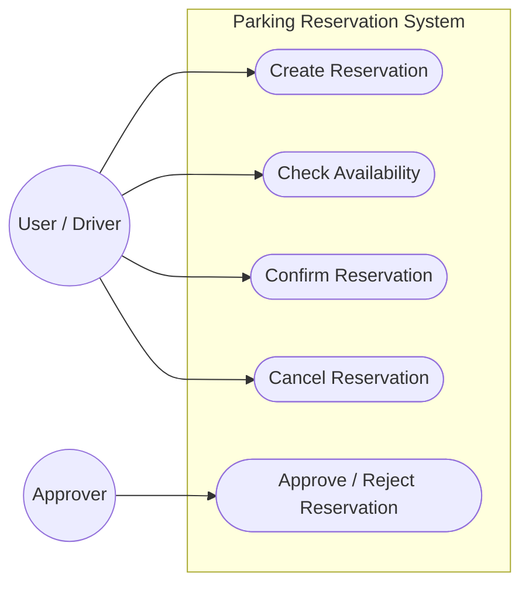
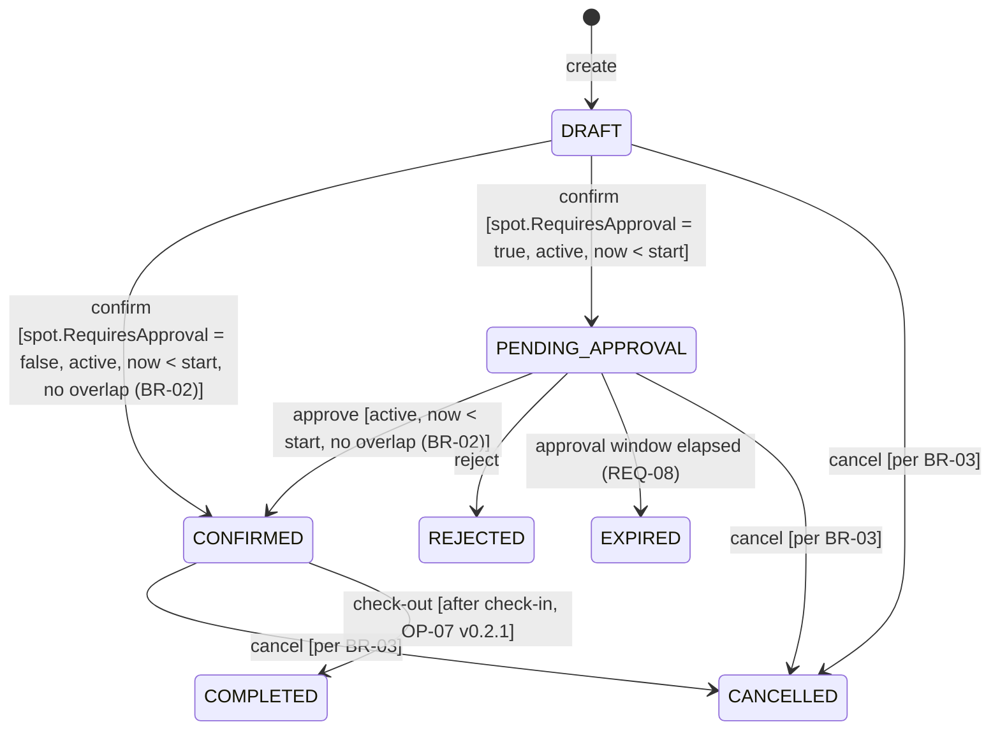
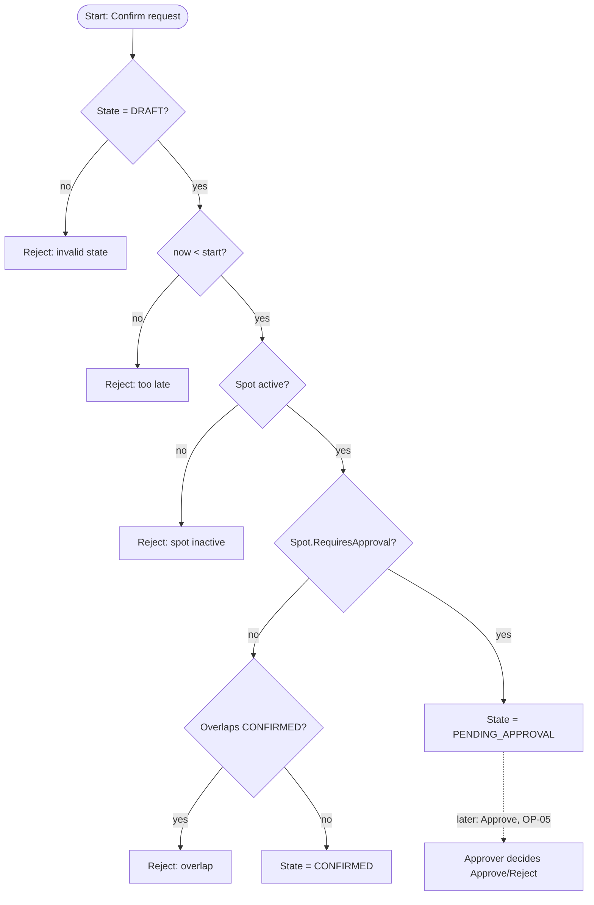
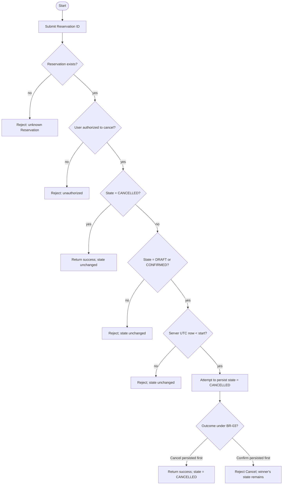
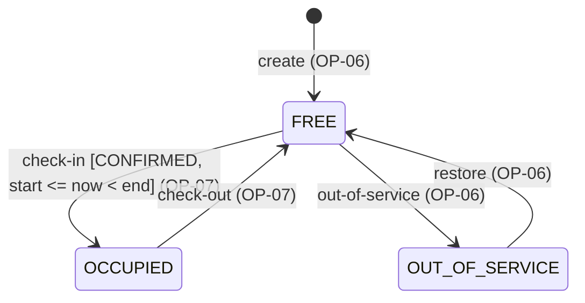

# Parking Reservation System — Specification

Status: **Baseline v0.2.1 — corrective revision 27 Nov 2026** (based on Baseline v0.2 approved by the team on 25 Oct 2026; v0.2.1 adds the authorization decision, the parking spot state, OP-06 and OP-07 — see section 6).

Domain reference: [intent-and-change.md](intent-and-change.md) (Project Frame z C01).

---

## 0. Decisions made before writing the operations

> Agreed by the team (2026-10-02).

**Resource:** `ParkingSpot` is an **exclusive** resource — at any moment it can have at most one `CONFIRMED` reservation (no capacity sharing).

**Cancellation policy (BR-03):**
A `DRAFT` or `CONFIRMED` reservation can be cancelled any time before `Reservation.start` (compared against the server UTC time). Cancelling an already `CANCELLED` reservation is an idempotent success (it stays `CANCELLED`, no error). If `start` has been reached or passed, Cancel is rejected. If `Cancel` and `Confirm` meet on the same reservation at the same time, the request persisted to the database first wins (handled by a transaction/lock in the C03 architecture — here we only define the observable result: at most one of them succeeds).

**Time axis:** all times (`start`, `end`, `currentTime`) are UTC (follows ADR-003 from C01). A time sent with an offset is converted to UTC; a time without a zone is treated as UTC (v0.2.1).

**Authorization (decided in v0.2.1, replaces the earlier TBDs in OP-01, OP-03, OP-04, OP-05):** a user has the role `Driver` or `Approver` and an `IsActive` flag.
- Create (OP-01) is allowed only for an active `Driver`.
- Confirm (OP-03) and Cancel (OP-04) are allowed only for the active `Driver` who created the reservation (the owner).
- Approve/Reject (OP-05), managing areas and spots (OP-06) and check-in/check-out (OP-07) are allowed for any active `Approver`; restricting an Approver to a specific area is out of scope.
- Check Availability (OP-02) is a public read.
- Identity is local (`userId` in the request); an external identity provider is out of scope (ADR-006, risk in the evidence).

---

## 1. Domain rules and invariants (BR)

> Defined once; operations only reference these rules.

### BR-01 — Interval semantics
Reservation intervals use `[start,end)` semantics (the end of the interval is exclusive).

### BR-02 — Exclusive Resource invariant
At no committed system state may two `CONFIRMED` Reservations overlap for the same `ParkingSpot`.

### BR-03 — Cancellation policy
A `DRAFT`, `CONFIRMED`, or `PENDING_APPROVAL` (v0.2) Reservation may be cancelled any time before `Reservation.start` (server UTC time). Cancelling an already `CANCELLED` Reservation is an idempotent success. A Reservation whose `start` has been reached or passed cannot be cancelled. A Reservation in a terminal non-cancelled state (`REJECTED`, `EXPIRED` - v0.2) cannot be cancelled either, since there is nothing left to withdraw. If `Cancel` and `Confirm`/`Approve` race on the same Reservation, at most one of them succeeds (whichever is persisted first).

### BR-04 — Domain-specific rule from C01
A Reservation of a `ParkingSpot` of type `EV_CHARGING` or `DISABLED` may be created only by a user whose vehicle/permit actually matches that type (electric vehicle, disabled parking permit) — checked at `Create Reservation`. (Taken from [intent-and-change.md](intent-and-change.md).)

### BR-05 — Approval gate (v0.2)
A Reservation on a `ParkingSpot` with `RequiresApproval = true` can reach `CONFIRMED` only via `Approve` (OP-05), never directly via `Confirm` (OP-03). A Reservation on a `ParkingSpot` with `RequiresApproval = false` is unaffected and confirms directly, as in v0.1.

### BR-06 — Spot operability (v0.2.1)
A `ParkingSpot` is *active* exactly when its state is not `OUT_OF_SERVICE` (one source of truth). An `OUT_OF_SERVICE` spot is never reported as available (OP-02, area availability) and no Reservation on it can be confirmed or approved (OP-03, OP-05). Only an Approver changes it (OP-06): `FREE → OUT_OF_SERVICE` and `OUT_OF_SERVICE → FREE`; a physically occupied spot cannot be taken out of service.

### BR-07 — Physical occupancy (v0.2.1)
The stored spot state reflects only operation and physical presence: `FREE`, `OCCUPIED`, `OUT_OF_SERVICE`. `RESERVED` is never stored; it is a derived view meaning “a `CONFIRMED` Reservation overlaps the queried interval”. Occupancy is bound to one specific `CONFIRMED` Reservation by check-in, allowed only within its interval `[start, end)` on a `FREE` spot. Check-out ends that Reservation (`COMPLETED`), which then no longer blocks the rest of its interval. Confirm, Approve, Cancel, Reject and expiry never change the spot state.

---

## 2. Operations

### OP-01 — Create Reservation

```
Goal / user value:
Driver creates a reservation request for a ParkingSpot that can later
be confirmed.

Trigger:
Authorized User (driver) requests a Reservation for ParkingSpot S and
interval I.

Observable requirement:
REQ-01:
The system shall create a DRAFT Reservation for an existing ParkingSpot
when the requested interval is valid and, if the spot type requires it
(EV_CHARGING or DISABLED), the requesting user/vehicle satisfies BR-04.

Preconditions:
- User is authorized to create Reservations.
- ParkingSpot exists.
- start < end (BR-01).
- If ParkingSpot.Type is EV_CHARGING or DISABLED, the user/vehicle
  satisfies BR-04.

Success postcondition:
- one new Reservation exists;
- Reservation.state = DRAFT;
- no ParkingSpot allocation is committed yet (BR-02 only constrains
  CONFIRMED reservations).

State change:
[none] → DRAFT

Referenced rules:
BR-01, BR-04

Main success scenario:
1. User submits ParkingSpot id, interval, and (if relevant) vehicle info.
2. System validates authorization, ParkingSpot existence, interval
   validity and BR-04 eligibility.
3. System creates Reservation in DRAFT.
4. System returns the Reservation identifier and current state.

Alternative / failure outcomes:
- unauthorized User → reject; no Reservation created;
- unknown ParkingSpot → reject; no Reservation created;
- invalid interval (start >= end) → reject; no Reservation created;
- EV_CHARGING/DISABLED spot requested without matching vehicle/permit
  → reject (BR-04); no Reservation created.

Verification examples:
valid STANDARD ParkingSpot + [10:00,11:00) → one DRAFT created
start == end → rejected
unknown ParkingSpot id → rejected
EV_CHARGING spot + non-electric vehicle → rejected

Rationale:
Creation records driver intent without committing spot allocation;
BR-04 eligibility depends on static vehicle/user attributes, not on
concurrent reservations, so it is checked here rather than at Confirm.

Assumption / unknown / TBD:
TBD — the source of the information "the vehicle is electric / has a
disabled permit" (part of the create request, or the user profile?) is not decided yet.
```

### OP-02 — Check Availability

```
Goal / user value:
User can determine whether a ParkingSpot is available for a requested
interval before attempting to reserve it.

Trigger:
User requests availability of ParkingSpot S for interval I.

Observable requirement:
REQ-02:
The system shall report a ParkingSpot as unavailable if the ParkingSpot
is not active, or if the interval overlaps any CONFIRMED Reservation of
that ParkingSpot; otherwise, for a valid interval, it shall report it as
available.

Preconditions:
- ParkingSpot exists.
- requested interval is valid (BR-01).

Success postcondition:
- availability result is returned;
- no Reservation state is changed.

Referenced rules:
BR-01, BR-02

Verification examples:
Existing CONFIRMED: [10:00,11:00)

query [09:00,10:00) → AVAILABLE
query [10:30,11:30) → UNAVAILABLE
query [11:00,12:00) → AVAILABLE
inactive ParkingSpot, no reservations at all → UNAVAILABLE

Accepted semantics:
Intervals are half-open: [start,end).

Rationale:
A ParkingSpot that is not active (OUT_OF_SERVICE) is never offered as
available, regardless of its reservations — consistent with the
invariant from C01 (docs/intent-and-change.md) and with OP-03, which
also rejects Confirm on an inactive ParkingSpot. Create (OP-01)
deliberately stays unaffected: it only records intent and does not
allocate, so it is still allowed on an inactive ParkingSpot.

Assumption / unknown / TBD:
DRAFT reservations do not block availability — only CONFIRMED ones do
(follows from BR-02 and from the fact that OP-01 does not allocate the spot yet).
```

### OP-03 — Confirm Reservation

```
Goal / user value:
A valid DRAFT Reservation becomes the accepted allocation of the
ParkingSpot.

Trigger:
Authorized User requests confirmation of Reservation X.

Observable requirements:
REQ-03:
The system shall confirm a DRAFT Reservation only when its ParkingSpot is
active and its interval does not overlap any existing CONFIRMED
Reservation of the same ParkingSpot.

REQ-04 (concurrency):
For concurrent confirmation attempts that conflict under BR-02, at most
one Reservation shall reach CONFIRMED; the others are rejected and remain
DRAFT.

Preconditions:
- Reservation X exists.
- Reservation X.state = DRAFT.
- User is authorized to confirm Reservation X.
- current time < Reservation X.start (server UTC time).

Success postcondition:
- Reservation X.state = CONFIRMED;
- Reservation X blocks its ParkingSpot for [start,end) (BR-01);
- BR-02 remains true.

State change:
DRAFT → CONFIRMED

Referenced rules:
BR-01 (interval semantics [start,end)), BR-02 (exclusive ParkingSpot).

Main success scenario:
1. User submits the Reservation identifier.
2. System loads Reservation X and verifies authorization, that
   state = DRAFT and that current time < start.
3. System verifies that the ParkingSpot of Reservation X is active.
4. System verifies that the interval of Reservation X does not overlap
   any CONFIRMED Reservation of the same ParkingSpot (BR-01, BR-02).
5. System sets Reservation X.state = CONFIRMED.
6. System returns the Reservation identifier and current state.

Failure outcomes:
- unknown Reservation → reject; nothing changes;
- unauthorized User → reject; state unchanged;
- state ≠ DRAFT (including already CONFIRMED or CANCELLED) → reject;
  state unchanged;
- start reached or passed → reject; state unchanged;
- ParkingSpot not active → reject; Reservation remains DRAFT;
- interval overlaps an existing CONFIRMED Reservation of the same
  ParkingSpot → reject; Reservation remains DRAFT;
- concurrent conflicting confirmations → exactly one succeeds, the others
  are rejected and remain DRAFT;
- concurrent Confirm and Cancel on the same Reservation → exactly one of
  them takes effect (BR-03); the Reservation is never both CONFIRMED and
  CANCELLED.

Verification examples:
DRAFT + active ParkingSpot + no overlap → CONFIRMED
Existing CONFIRMED [10:00,11:00), DRAFT [10:30,11:30) → rejected, DRAFT
Existing CONFIRMED [10:00,11:00), DRAFT [11:00,12:00) → CONFIRMED
  (boundary only touches, BR-01)
DRAFT on inactive ParkingSpot → rejected, DRAFT
Confirm an already CONFIRMED Reservation → rejected, state unchanged
DRAFT with start in the past (start <= current time) → rejected, state
  unchanged
Concurrent Confirm and Cancel on the same DRAFT → exactly one takes
  effect; final state is either CONFIRMED or CANCELLED, never both
Two concurrent conflicting DRAFTs on the same ParkingSpot → exactly one
  CONFIRMED, the other rejected and DRAFT
Two concurrent DRAFTs on different ParkingSpots → both CONFIRMED

Acceptance check:
- Meaning: confirmation commits the allocation of the ParkingSpot for
  [start,end).
- Observable result: the returned state is CONFIRMED on success; on
  rejection the Reservation is observably still DRAFT (or unchanged).
- State/time: only DRAFT → CONFIRMED is possible, and only before
  start; intervals are [start,end), so touching boundaries do not
  conflict.
- Concurrency: for conflicting concurrent attempts at most one reaches
  CONFIRMED.
- Consistency: after any outcome BR-02 holds (no two overlapping
  CONFIRMED Reservations on one ParkingSpot).

Rationale:
The allocation is committed only at Confirm (Create does not allocate),
so exclusivity of the ParkingSpot is checked here; concurrency is a
business outcome, not just an implementation detail.

Assumption / unknown / TBD:
Resolved in v0.2.1 — only the active Driver who owns the Reservation may
confirm (section 0, Autorizace).
Assumption — Confirm is rejected once Reservation.start has been reached
or passed (consistent with BR-03 time semantics; decided in this
revision).
TBD — source of "current time" (server clock assumed, UTC); clock
accuracy/synchronization is not specified.
TBD — whether failure of the Notification Service cancels the confirm or
is best-effort (confirm stays valid).
TBD — which of several conflicting concurrent confirmations wins; only
"at most one" is specified, no fairness/ordering rule is defined.
Concurrent Confirm vs. Cancel is governed by BR-03 (at most one of them
succeeds); no further TBD here, OP-04 must stay consistent with it.
Resolved in v0.2.1 — "ParkingSpot is active" means state ≠ OUT_OF_SERVICE
(BR-06); only an Approver changes it (OP-06).
```

### OP-04 — Cancel Reservation

```
Goal / user value:
User can cancel a Reservation before its start, preventing a DRAFT from
being confirmed or releasing a CONFIRMED allocation.

Trigger:
Authorized User requests cancellation of Reservation X.

Observable requirement:
REQ-05:
The system shall transition a DRAFT or CONFIRMED Reservation to CANCELLED
when an authorized cancellation request is made before Reservation.start
(server UTC time). A request to cancel an already CANCELLED Reservation
shall succeed without changing its state. Cancellation at or after start
shall be rejected. If Confirm and Cancel race on the same Reservation, at
most one of them succeeds (BR-03).

Preconditions:
- Reservation X exists.
- User is authorized to cancel Reservation X (the authorization scope is
  not yet defined).
- For a non-CANCELLED Reservation, current time < Reservation.start
  (server UTC time); otherwise the request is rejected per BR-03.

Success postcondition:
- For a DRAFT or CONFIRMED Reservation, Reservation X.state = CANCELLED.
- The cancelled Reservation no longer blocks its ParkingSpot as a
  CONFIRMED Reservation (BR-02).
- For an already CANCELLED Reservation, the request succeeds and the
  state remains CANCELLED (idempotent; BR-03).

State change:
DRAFT → CANCELLED
CONFIRMED → CANCELLED
CANCELLED → CANCELLED (idempotent success; no state change)

Referenced rules:
BR-02, BR-03

Main success scenario:
1. User submits the Reservation identifier.
2. System loads Reservation X and verifies the user's authorization.
3. If Reservation X is already CANCELLED, the system returns success with
   its current state and makes no state change.
4. Otherwise, the system verifies that Reservation X is DRAFT or
   CONFIRMED and that current time < Reservation X.start.
5. The system persists Reservation X.state = CANCELLED. If Confirm and
   Cancel race on X, only the request persisted first succeeds (BR-03).
6. System returns the Reservation identifier and current state.

Failure outcomes:
- unknown Reservation → reject; nothing changes;
- unauthorized User → reject; state unchanged;
- Reservation.start reached or passed for a non-CANCELLED Reservation →
  reject; state unchanged;
- a concurrent Confirm request was persisted first → reject this Cancel
  request; no second transition occurs, and the winner determines the
  resulting state (BR-03).

Verification examples:
DRAFT + current time < start → CANCELLED
CONFIRMED + current time < start → CANCELLED; no longer blocks the spot
CANCELLED + current time >= start → success; remains CANCELLED
DRAFT or CONFIRMED + current time >= start → rejected; state unchanged
Concurrent Confirm and Cancel on the same Reservation → at most one
  succeeds; the final state is CONFIRMED or CANCELLED, never both

Rationale:
Cancellation is an explicit state transition rather than deletion.
Idempotent success for an already CANCELLED Reservation makes a repeated
request safe, while BR-03 prevents cancellation once the reserved interval
has started.

Assumption / unknown / TBD:
Resolved in v0.2.1 — only the active Driver who owns the Reservation may
cancel (section 0, Autorizace). COMPLETED (after check-out, OP-07) is a
terminal state and cannot be cancelled.
TBD — whether cancellation sends a notification and how Notification
Service failure affects the result.
```

### OP-04 — Cancel Reservation *(addendum for v0.2)*

The text above (v0.1) remains valid; `PENDING_APPROVAL` is added to it in the same way as `DRAFT`/`CONFIRMED`, while `REJECTED`/`EXPIRED` are newly excluded (they cannot be cancelled):

```
REQ-05 (v0.2 addendum):
The system shall also transition a PENDING_APPROVAL Reservation to
CANCELLED under the same condition (current time < start), per BR-03.
A Reservation in state REJECTED or EXPIRED cannot be cancelled - the
request is rejected as an invalid source state (there is no pending
allocation or request left to withdraw).

State change (v0.2 addendum):
PENDING_APPROVAL → CANCELLED

Verification examples (v0.2 addendum):
PENDING_APPROVAL + current time < start → CANCELLED
REJECTED or EXPIRED (any time) → rejected; invalid source state
```

---

## 3. Diagrams

### 3a. Use case diagram (actors and goals) — v0.2



v0.2 addendum: the actor **Approver** and the goal **Approve / Reject Reservation** (OP-05) were added. The other goals and the Driver actor are unchanged from v0.1.

### 3b. Reservation state diagram — v0.2



Notes:
- No `confirm`/`approve`/`reject` transition leads from `CONFIRMED`, `CANCELLED`, `REJECTED`, `EXPIRED`; such requests are rejected (OP-03/OP-05).
- A rejected `confirm`/`approve` (inactive spot, overlap, race, start already reached or passed) does not change the state — the Reservation stays in its original state (`DRAFT` or `PENDING_APPROVAL`).
- `cancel` of an already `CANCELLED` reservation is an idempotent success without a state change (BR-03); `cancel` on `REJECTED`/`EXPIRED` is rejected (BR-03 v0.2 — nothing left to withdraw).
- `REJECTED`, `EXPIRED` and `COMPLETED` (v0.2.1) are terminal — no further transition leads from them.
- Check-in (OP-07) does not change the reservation state; it only records `CheckedInAt` and occupies the spot (BR-07).
- v0.1 (without `RequiresApproval`) corresponds exactly to the `DRAFT --> CONFIRMED` edge above — nothing changes for those spots.

### 3d. Activity diagram — Confirm/Approve branching (v0.2)



### 3c. Activity diagram — Cancel Reservation



The use-case actor covers the user goals in OP-01 through OP-04; operation
authorization requirements and the still-undefined cancellation scope are
specified in the operation text.

The activity diagram shows the idempotent path before the start-time check:
an already CANCELLED Reservation succeeds without a state change, as
required by BR-03. A competing Confirm that is persisted first causes the
Cancel request to be rejected (BR-03).

---

## 4. Consistency check (item 10 of the assignment)

| Check | Status | Note |
|---|---|---|
| Create vs. Confirm | ☑ | Create (OP-01) never allocates the spot (no overlap check); exclusivity (BR-02) is enforced only at Confirm (OP-03). Consistent. |
| Availability vs. Confirm | ☑ | **Resolved (agreed by the team 2026-10-11):** REQ-02 now takes `ParkingSpot.IsActive` into account in the same way as OP-03 — an inactive spot is always `UNAVAILABLE`, regardless of reservations. Create (OP-01) stays unchanged, because it only records intent and allocates nothing. |
| Cancel vs. state diagram | ☑ | OP-04 state changes match BR-03 and section 3b. |
| Meaning of intervals across operations | ☑ | OP-01, OP-02, OP-03 consistently use `[start,end)` (BR-01); the boundary example in OP-03 (touching at 11:00) matches OP-02. |
| Use-case diagram vs. text | ☑ | The diagram covers the user goals in OP-01 through OP-04. |
| Requirement vs. design decision | ☑ | No requirement prescribes an implementation/technology (DB, framework) — only observable behavior. |
| Uncertainty vs. invented precision | ☑ | Unclear points (authorization, Notification Service, clock accuracy, fairness under concurrency) are explicitly marked as Assumption/TBD everywhere, not invented. |

**Approved as Specification Baseline v0.1:** ☑ yes / date: 11 Oct 2026 / by: Jan Ječmínek

---

## 5. Part B — Change: approval workflow

> The proposal was drafted in C02 with AI assistance; the team reviewed it and **approved it on 25 Oct 2026** as Baseline v0.2 (see the end of the section). The text below is kept as approved.

**C02 change (assignment):** Some Resources require approval by an authorized person before a Reservation can become CONFIRMED. The approval may be delayed, rejected, or it may expire.

**Key decisions (proposed):**
- Which ParkingSpots require approval is given by a new attribute `ParkingSpot.RequiresApproval` (bool), independent of `Type` — "some", not a whole category.
- For a spot **without** `RequiresApproval` nothing changes — Confirm (OP-03) works exactly as in v0.1.
- For a spot **with** `RequiresApproval`, Confirm is not split into a new "request approval" operation — it is still Confirm (same trigger, same form), only its result for `RequiresApproval = true` is not `CONFIRMED` directly but `PENDING_APPROVAL`. A new **OP-05 Approve Reservation** is introduced, performed by a new actor (Approver), and only that leads to `CONFIRMED` or `REJECTED`.

### Impact analysis (item 12)

| Area | Answer |
|---|---|
| Create | Unchanged. Create still only records intent (DRAFT) and does not check the spot's `RequiresApproval` flag at all — that matters only at Confirm. |
| Availability | Logic unchanged, only a new consideration: `PENDING_APPROVAL` **does not block** availability, just as `DRAFT` does not block today — only `CONFIRMED` blocks (BR-02). Reason: an approval can be rejected or expire, so it would be wrong to temporarily "lock" the slot just because of a pending request. |
| Confirm | Changes: it is no longer always an immediate operation. For `RequiresApproval = false` unchanged (→ CONFIRMED). For `RequiresApproval = true` → `PENDING_APPROVAL` (without an overlap check — it moves to Approve, by the same logic as Create does not check overlap today and Confirm does). |
| Approve | A new operation (OP-05) and a new actor (Approver) are introduced. Who exactly may approve is TBD (just like "who may confirm/cancel" in v0.1). |
| Cancel | Extended: `PENDING_APPROVAL` can be cancelled (the requester can withdraw the request before it is decided), under the same condition `now < start` as DRAFT/CONFIRMED today (BR-03). `REJECTED` and `EXPIRED` are new terminal states — cancel on them is rejected (they are not "active" reservations). |
| State diagram | New states `PENDING_APPROVAL`, `REJECTED`, `EXPIRED` and transitions `confirm` (conditioned by `RequiresApproval`), `approve`, `reject`, time-based expiry. See the updated diagram 3b. |
| Use case diagram | New actor Approver and goal "Approve/Reject Reservation". See the updated diagram 3a. |
| Verification | New verification examples in OP-03 (move to PENDING_APPROVAL) and OP-05 (approve/reject/expired). Tested in `tests/` (see evidence). |
| Architecture | Expiry requires knowing "how long we have been waiting" → a new persistent field on Reservation. In C02 handled lazily (checked whenever the reservation is touched), not by a timer/job — that is an architecture driver for C03 (see below). Approve/Reject also strengthens the case for the Notification Service boundary (notify the requester of the result, notify the Approver of a new request). |

### Impact of the C02 change (item 13)

```
Changed condition:
Some ParkingSpots (flag RequiresApproval) require approval by an authorized
person (Approver) before a Reservation reaches CONFIRMED; the approval may be
delayed, rejected (REJECTED), or it may expire (EXPIRED).

Affected requirements / parts of the specification:
- OP-03 (REQ-03): extended by the RequiresApproval condition - see the
  updated text.
- BR-03 (cancellation policy): extended by PENDING_APPROVAL as a cancellable
  state.
- State diagram (3b) and use case diagram (3a): updated to v0.2.

Unaffected requirements / parts + why:
- OP-01 Create: unchanged - Create does not distinguish RequiresApproval, it
  still only records intent as DRAFT.
- OP-02 Check Availability (REQ-02): unchanged - PENDING_APPROVAL/REJECTED/
  EXPIRED are not CONFIRMED, so they do not enter the availability
  calculation already under the current wording of REQ-02 (only IsActive +
  CONFIRMED overlap).
- BR-01 (interval semantics), BR-02 (exclusive resource invariant):
  unchanged - overlap is still computed only between CONFIRMED reservations;
  only the moment it happens moves for approval spots (Approve instead of
  Confirm).
- BR-04 (EV/DISABLED eligibility from C01): unchanged, independent rule.

New actor / operation, if any:
- Actor: Approver - an authorized person deciding requests on spots with
  RequiresApproval = true. The exact scope of authority is TBD.
- Operation: OP-05 Approve Reservation (includes an explicit reject).

Changed rules / meaning of states:
- BR-03 extended: PENDING_APPROVAL can be cancelled under the same condition
  (now < start) as DRAFT/CONFIRMED.
- New BR-05 (see section 1): CONFIRMED can be reached for a RequiresApproval
  spot only via Approve, never directly via Confirm.
- REJECTED and EXPIRED are new terminal states, with no way back.

Use case diagram change:
Added actor Approver and goal "Approve / Reject Reservation" (see 3a).

State diagram change:
Added states PENDING_APPROVAL, REJECTED, EXPIRED and transitions confirm
(conditioned by RequiresApproval), approve, reject, expiry (see 3b).

New verification examples:
- Confirm on a RequiresApproval spot -> PENDING_APPROVAL (not CONFIRMED).
- Successful approve (active spot, now<start, no overlap) -> CONFIRMED.
- Approve with an overlap -> rejected, stays PENDING_APPROVAL.
- Reject -> REJECTED (terminal).
- PENDING_APPROVAL after the window elapsed -> EXPIRED on next access.
- Cancel on PENDING_APPROVAL before start -> CANCELLED.
- Cancel on REJECTED/EXPIRED -> rejected (invalid source state).

Architecture drivers for C03:
- Expiry is now handled by a lazy re-evaluation whenever the reservation is
  touched, not by a timer - a reservation nobody touches stays "effectively
  expired but formally PENDING_APPROVAL" in the DB until something loads it.
  Needs either a background job or a scheduled query (future pressure Q/L).
- Approve/Reject and expiry are natural points for connecting the
  Notification Service (boundary from C01/intent-and-change.md) - not
  addressed yet.
- SpotLocks (ADR-004) must now serialize Approve as well - it stays
  in-process; the limit for multiple application instances remains.
```

### OP-03 — Confirm Reservation *(addendum for v0.2, see the text in section 2)*

The OP-03 text in section 2 remains valid for `ParkingSpot.RequiresApproval = false`. For `RequiresApproval = true`, REQ-03 changes as follows:

```
REQ-03 (v0.2 addendum):
If the ParkingSpot has RequiresApproval = true, the system shall instead
transition a DRAFT Reservation to PENDING_APPROVAL (not CONFIRMED) when
the ParkingSpot is active and current time < Reservation.start. The
overlap check against other CONFIRMED Reservations (BR-02) is deferred
to OP-05 Approve, not performed here.

Verification examples (v0.2 addendum):
DRAFT on a RequiresApproval spot, active, now < start -> PENDING_APPROVAL
  (even if another CONFIRMED Reservation already overlaps - the conflict
  is caught later, at Approve)
```

### OP-05 — Approve Reservation

```
Goal / user value:
An authorized Approver decides a PENDING_APPROVAL Reservation on a spot
that requires approval: grant it (become the committed allocation) or
refuse it.

Trigger:
Authorized Approver requests approve or reject of Reservation X.

Observable requirements:
REQ-06 (approve):
The system shall transition a PENDING_APPROVAL Reservation to CONFIRMED
when its ParkingSpot is active, current time < Reservation.start, and its
interval does not overlap any existing CONFIRMED Reservation of the same
ParkingSpot (BR-02). Otherwise the approve request is rejected and the
Reservation remains PENDING_APPROVAL.

REQ-07 (reject):
The system shall transition a PENDING_APPROVAL Reservation to REJECTED
when an authorized Approver explicitly rejects it, regardless of overlap.

REQ-08 (expiry):
A PENDING_APPROVAL Reservation whose approval window has elapsed (exact
duration TBD - see Assumption) shall be treated as EXPIRED on its next
access (approve, reject, or cancel attempt), instead of being approved or
rejected.

Preconditions:
- Reservation X exists.
- Reservation X.state = PENDING_APPROVAL (otherwise: not expired-checked
  from a state this operation cannot act on).
- Approver is authorized (scope TBD).
- For approve: ParkingSpot is active, current time < Reservation.start,
  no overlapping CONFIRMED Reservation of the same ParkingSpot.

Success postcondition (approve):
- Reservation X.state = CONFIRMED;
- Reservation X blocks its ParkingSpot for [start,end) (BR-01, BR-02).

Success postcondition (reject):
- Reservation X.state = REJECTED (terminal, no further transitions).

State change:
PENDING_APPROVAL → CONFIRMED (approve)
PENDING_APPROVAL → REJECTED (reject)
PENDING_APPROVAL → EXPIRED (approval window elapsed, detected lazily)

Referenced rules:
BR-01, BR-02, BR-05

Main success scenario (approve):
1. Approver submits the Reservation identifier and chooses "approve".
2. System loads Reservation X; if its approval window has elapsed,
   transitions it to EXPIRED instead and stops (REQ-08).
3. System verifies Approver authorization and that state = PENDING_APPROVAL.
4. System verifies the ParkingSpot is active and current time < start.
5. System verifies no overlap with an existing CONFIRMED Reservation of
   the same ParkingSpot (BR-02).
6. System sets Reservation X.state = CONFIRMED.
7. System returns the Reservation identifier and current state.

Failure outcomes:
- unknown Reservation → reject; nothing changes;
- unauthorized Approver → reject; state unchanged;
- state ≠ PENDING_APPROVAL (already CONFIRMED/REJECTED/CANCELLED, or
  DRAFT on a non-approval spot) → reject; state unchanged;
- approval window elapsed → Reservation becomes EXPIRED instead (REQ-08);
  the approve/reject request itself is rejected as "no longer pending";
- approve: ParkingSpot not active → reject; stays PENDING_APPROVAL;
- approve: current time ≥ start → reject; stays PENDING_APPROVAL;
- approve: overlaps an existing CONFIRMED Reservation → reject; stays
  PENDING_APPROVAL (requester or Approver must resolve, e.g. via Cancel);
- reject: always succeeds while state = PENDING_APPROVAL and not expired,
  regardless of overlap or ParkingSpot activity.

Verification examples:
PENDING_APPROVAL + active spot + no overlap + approve → CONFIRMED
PENDING_APPROVAL + overlapping CONFIRMED + approve → rejected, stays
  PENDING_APPROVAL
PENDING_APPROVAL + reject → REJECTED
PENDING_APPROVAL + approval window elapsed + approve attempt → EXPIRED
  (not CONFIRMED)
PENDING_APPROVAL + start already passed + approve → rejected, stays
  PENDING_APPROVAL
Already CONFIRMED + approve attempt → rejected (invalid state)

Rationale:
Approve re-checks exactly what Confirm would have checked directly (BR-02,
active spot, timing) because the overlap could only be meaningfully
evaluated once a human decision is imminent; reject needs no such check
because it never commits an allocation. Expiry is checked lazily (on
access) rather than by a background process, consistent with "neoptimalizujte
architekturu v C02" - a real timer/scheduler is an explicit driver for C03.

Assumption / unknown / TBD:
Resolved in v0.2.1 — any active Approver may approve/reject (section 0,
Autorizace); scoping approvers to particular areas is out of scope.
TBD — exact approval window duration (how long a PENDING_APPROVAL may
wait before EXPIRED) is not decided; current code uses a placeholder
value for demonstration only, not a business decision.
TBD — whether an expired or rejected Reservation triggers a new DRAFT
automatically, or the requester must start over with a new Create - this
spec assumes the requester must create a new Reservation.
TBD — whether Notification Service failure affects approve/reject
(same open question as already noted in OP-03).
```

### Consistency check v0.2

| Check | Status | Note |
|---|---|---|
| Confirm vs. BR-05 | ☑ | The OP-03 addendum matches BR-05 exactly: `RequiresApproval = true` goes to `PENDING_APPROVAL`, never directly to `CONFIRMED`. |
| Approve vs. state diagram (3b) | ☑ | All three transitions of OP-05 (approve→CONFIRMED, reject→REJECTED, expiry→EXPIRED) are in diagram 3b. |
| Cancel vs. extended BR-03 | ☑ | OP-04 now has a v0.2 addendum that writes `PENDING_APPROVAL` and the exclusion of `REJECTED`/`EXPIRED` directly into the operation text, not only into BR-03. |
| Use case diagram vs. OP-05 | ☑ | The Approver actor and the goal "Approve / Reject Reservation" (3a) match OP-05. |
| Uncertainty vs. invented precision (approval window) | ☑ | The exact window length is explicitly TBD in OP-05; the code uses only a placeholder — no invented "official" value pretends to be a decision. |

**Approved as Specification Baseline v0.2:** ☑ yes / date: 25 Oct 2026 / by: the project team

---

## 6. Baseline v0.2.1 — spot state, check-in/check-out and authorization

**Reason for the revision:** the internal audit of 27 Nov 2026 (`docs/evidence-and-evolution.md`, section *C07 — Internal audit*) found functionality implemented in `eaae325` without a specification (spot management, OUT_OF_SERVICE, check-in/out) and five resulting defects: a reservable out-of-service spot, two different availability rules, a global spot state, a spot locked after rejection, and check-in without a time window. v0.2.1 adds this behavior to the specification and corrects it. OP-01 to OP-05 do not change except for references to BR-06 and BR-07.

### OP-02 — Check Availability *(addendum v0.2.1)*

```
REQ-02 (v0.2.1 addendum):
"Not active" in REQ-02 means OUT_OF_SERVICE (BR-06). Additionally, a spot
that is physically OCCUPIED is unavailable for an interval that contains
the current time (BR-07). The per-spot query (OP-02) and the per-area
query use exactly the same rule; the per-area query also reports the
spot state for the interval: OUT_OF_SERVICE / OCCUPIED as stored,
RESERVED if a CONFIRMED Reservation overlaps the interval, else FREE.

Verification examples (v0.2.1):
OUT_OF_SERVICE spot, no reservations → UNAVAILABLE (both queries)
CONFIRMED [10:00,11:00), area query [10:30,12:00) → UNAVAILABLE, RESERVED
COMPLETED reservation (checked out) → does not block its remaining interval
```

### OP-06 — Manage Parking Areas and Spots

```
Goal / user value:
Approver (parking manager) maintains the parking areas and spots that
drivers can reserve, and takes broken spots out of service.

Trigger:
Authorized Approver creates an area, creates a spot in an area, takes a
spot out of service, or restores it.

Observable requirement:
REQ-09:
The system shall let an active Approver create a ParkingArea (non-empty
name) and a ParkingSpot in an existing area; a new spot is FREE.
REQ-10:
The system shall let an active Approver set a FREE spot to OUT_OF_SERVICE
and an OUT_OF_SERVICE spot back to FREE (BR-06); any other source state is
rejected and nothing changes.

Preconditions:
- user is an active Approver;
- area exists (spot creation);
- spot exists and is in the required source state (out-of-service/restore).

Success postcondition:
- new area/spot is persisted; or the spot state is OUT_OF_SERVICE / FREE.

State change (ParkingSpot):
[none] → FREE (create)
FREE → OUT_OF_SERVICE
OUT_OF_SERVICE → FREE

Referenced rules:
BR-06

Failure outcomes:
- Driver or inactive user → reject (unauthorized); nothing changes;
- empty area name → reject; nothing created;
- unknown area / spot → reject; nothing changes;
- OUT_OF_SERVICE from OCCUPIED or OUT_OF_SERVICE, restore from a non
  OUT_OF_SERVICE state → reject (invalid state); nothing changes.

Verification examples:
Approver creates area + spot → spot FREE
Driver creates area → unauthorized
FREE → out-of-service → OUT_OF_SERVICE; restore → FREE
OCCUPIED → out-of-service → rejected
PENDING_APPROVAL then REJECTED reservation → spot still FREE, can go
  OUT_OF_SERVICE

Assumption / unknown / TBD:
Taking a spot out of service does not cancel existing CONFIRMED
Reservations on it; they stay CONFIRMED but cannot be checked in while the
spot is OUT_OF_SERVICE. Notifying their drivers depends on the Notification
Service (not integrated) — known limitation.
RequiresApproval is set only directly in the database for now (no API).
```

### OP-07 — Check-in / Check-out

```
Goal / user value:
Approver records the physical arrival and departure of the vehicle for a
specific confirmed Reservation, so the spot state reflects reality and a
finished Reservation releases the spot.

Trigger:
Authorized Approver performs check-in or check-out of Reservation X.

Observable requirement:
REQ-11 (check-in):
The system shall check in a CONFIRMED, not yet checked-in Reservation when
current time is within [start, end) and its spot is FREE: the spot becomes
OCCUPIED and the Reservation records the check-in time (BR-07).
REQ-12 (check-out):
The system shall check out a checked-in CONFIRMED Reservation whose spot
is OCCUPIED: the Reservation becomes COMPLETED and the spot becomes FREE.

Preconditions:
- user is an active Approver;
- Reservation X exists;
- check-in: X.state = CONFIRMED, not checked in, start ≤ now < end, spot
  FREE (not OUT_OF_SERVICE, not OCCUPIED);
- check-out: X.state = CONFIRMED, checked in, spot OCCUPIED.

Success postcondition:
- check-in: spot OCCUPIED, X.checkedInAt = now, X.state stays CONFIRMED;
- check-out: X.state = COMPLETED, spot FREE; X no longer blocks [now, end).

State change:
ParkingSpot FREE → OCCUPIED (check-in), OCCUPIED → FREE (check-out)
Reservation CONFIRMED → COMPLETED (check-out)

Referenced rules:
BR-01, BR-06, BR-07

Failure outcomes:
- unauthorized user → reject; nothing changes;
- unknown Reservation → reject;
- check-in outside [start, end) → reject (outside reservation window);
  spot and Reservation unchanged;
- check-in when spot is OUT_OF_SERVICE or OCCUPIED → reject (spot
  unavailable);
- check-in twice, or of a non-CONFIRMED Reservation → reject (invalid
  state);
- check-out without check-in → reject (invalid state).

Verification examples:
CONFIRMED [10:00,11:00): check-in at 09:59 → rejected; 10:00 → OCCUPIED;
  10:59 → OCCUPIED; 11:00 → rejected
check-in at 10:10, check-out at 10:40 → COMPLETED, spot FREE,
  availability [11:00,12:00) → AVAILABLE
two CONFIRMED on one spot, first cancelled → second can still check in

Rationale:
Binding occupancy to a Reservation (instead of a global spot flag set by
Confirm) removes the conflict between a time-based allocation and a
single physical state. Check-in needs no cancel interaction: cancel is
allowed only before start (BR-03), check-in only from start.

Assumption / unknown / TBD:
No-show (a CONFIRMED Reservation without check-in) still blocks the spot
until end — addressed by Change Request CR-01 (C08,
docs/intent-and-change.md).
Overstay after end is not modelled: the spot stays OCCUPIED until
check-out.
```

### ParkingSpot state diagram — v0.2.1



`RESERVED` is not a stored state: area availability reports it for an interval overlapped by a `CONFIRMED` reservation (BR-07).

### Consistency check v0.2.1

| Check | Status | Note |
|---|---|---|
| OP-02 vs. availability oblasti | ☑ | Jedna metoda `IsSpotAvailableAsync`, test `Spot_and_area_availability_agree_and_area_reports_reserved`. |
| BR-06 vs. OP-03/OP-05 | ☑ | Confirm/Approve reject `OUT_OF_SERVICE` and do not change the spot state; test `Out_of_service_spot_is_unavailable_and_cannot_be_confirmed`. |
| BR-07 vs. Cancel (BR-03) | ☑ | Cancel only before `start`, check-in only from `start` → they never meet. |
| Reservation state diagram vs. OP-07 | ☑ | Added transition `CONFIRMED → COMPLETED`; `COMPLETED` is terminal for Cancel as well. |
| Authorization vs. code | ☑ | Section 0 matches `IsReservationOwnerDriverAsync` / `IsActiveApproverAsync` in `ReservationService`. |

**Revision v0.2.1:** prepared by Jan Ječmínek on 27 Nov 2026, reviewed in PR `fix/spot-state-audit` (the reviewer adds their name when approving the PR).

